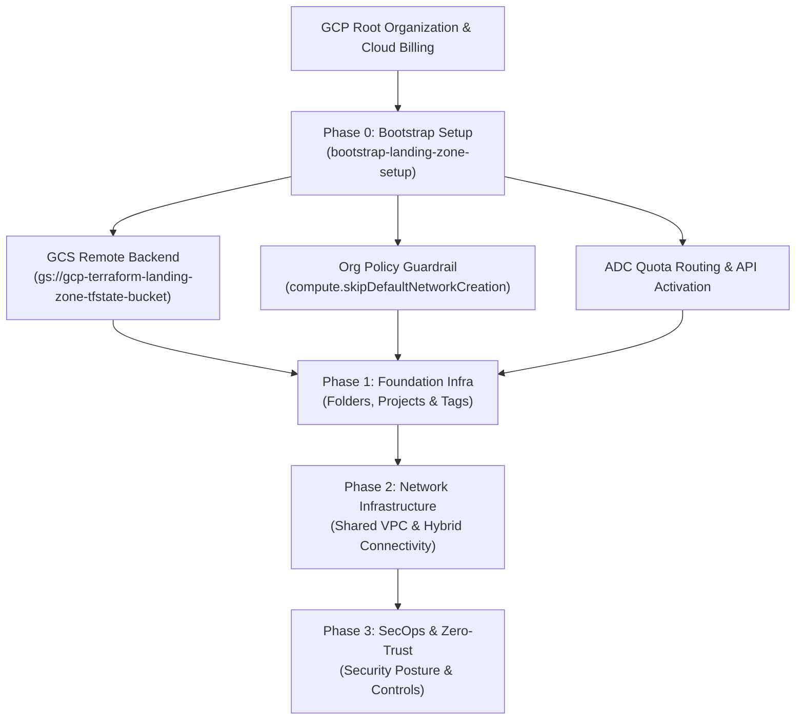

# Phase 0: Bootstrap & Governance Setup

This directory contains the foundational bootstrap architecture and prerequisites for deploying the **Google Cloud Platform (GCP) Landing Zone**. It establishes the initial management boundary, state persistence, quota routing, and organizational security policies before applying any foundation or workload infrastructure.

---

## Architecture & Bootstrap Sequence



---

## Bootstrap Components & Resource Details

| Component | Identifier / Name | Description |
| :--- | :--- | :--- |
| **Bootstrap Project** | `bootstrap-landing-zone-setup` | Dedicated administrative project for state management, billing quotas, and automation credentials. |
| **Region** | `asia-south1` | Regional location (Mumbai) for bootstrap infrastructure. |
| **GCS Remote State Bucket** | `gcp-terraform-landing-zone-tfstate-bucket` | Cloud Storage bucket storing versioned, encrypted Terraform state files across all phases. |
| **Bucket Access Control** | Uniform Bucket-Level Access (UBLA) | Enforces centralized Cloud IAM permissions, disabling legacy ACLs. |
| **Object Versioning** | Enabled | Preserves state file history and prevents accidental corruption or state deletion. |
| **Soft Delete Policy** | 7-day retention (`604800s`) | Prevents unrecoverable loss from accidental bucket or object deletion. |
| **Mandatory Org Policy** | `compute.skipDefaultNetworkCreation` | Enforces that no project is ever provisioned with an unhardened `default` VPC or open firewall rules. |

---

## Documentation Index & Guides

This phase is divided into two comprehensive operational guides:

### 1. [IAM Policies & Prerequisites Guide](./1-IAM-Policy.md)
* **File:** [`1-IAM-Policy.md`](./1-IAM-Policy.md)
* **Covers:**
  * Mandatory organizational identifiers (`Organization ID`, `Billing Account ID`).
  * Required IAM roles at the Organization level (`roles/resourcemanager.organizationAdmin`, `roles/resourcemanager.folderAdmin`, `roles/resourcemanager.projectCreator`, `roles/compute.xpnAdmin`, `roles/resourcemanager.tagAdmin`).
  * Billing account IAM bindings (`roles/billing.user`).
  * Pre-deployment validation checklist.

### 2. [Bootstrap Project & GCS Remote State Setup](./2-bootstrap-project.md)
* **File:** [`2-bootstrap-project.md`](./2-bootstrap-project.md)
* **Covers:**
  * Step-by-step CLI commands to create `bootstrap-landing-zone-setup`.
  * Enabling foundational GCP service APIs in one command (`cloudresourcemanager`, `orgpolicy`, `essentialcontacts`, `iam`, `serviceusage`, `cloudbilling`, `compute`).
  * GCS state bucket provisioning with UBLA, versioning, and soft-delete retention.
  * Local ADC quota configuration (`gcloud auth application-default set-quota-project bootstrap-landing-zone-setup`).
  * Enterprise service account impersonation standard.
  * State migration workflows (`terraform init -migrate-state`).
  * Comprehensive troubleshooting guide for common landing zone deployment errors.

---

## Quick Execution Checklist

To prepare the environment for Phase 1 Foundation deployment:

```powershell
# 1. Authenticate with Google Cloud
gcloud auth login
gcloud auth application-default login

# 2. Set ADC quota project to avoid Error 403 on Org APIs
gcloud auth application-default set-quota-project bootstrap-landing-zone-setup

# 3. Enable core APIs on the bootstrap project
gcloud services enable `
  cloudresourcemanager.googleapis.com `
  orgpolicy.googleapis.com `
  essentialcontacts.googleapis.com `
  iam.googleapis.com `
  serviceusage.googleapis.com `
  cloudbilling.googleapis.com `
  compute.googleapis.com `
  --project bootstrap-landing-zone-setup

# 4. Enforce skipDefaultNetworkCreation Org Policy
gcloud resource-manager org-policies enable-enforce compute.skipDefaultNetworkCreation `
  --organization="278632878375"
```

---

## Next Steps

Once bootstrap requirements are satisfied:
1. Proceed to **Phase 1: Foundation Infrastructure**:
   - [../1-foundation-infra/README.md](file:///d:/GCP-DevOps-WorkSpace/gcp-terraform-best-practices/2-gcp-landing-zone-terraform/1-foundation-infra/README.md)
