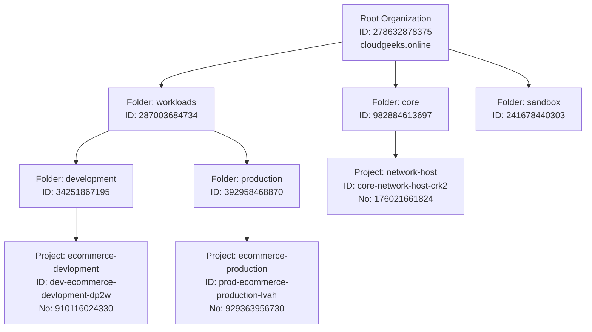

# GCP Landing Zone: Foundation Infrastructure

This directory contains the **Foundation Infrastructure** layer for the Google Cloud Landing Zone. It provisions the core organizational structure, folder hierarchies, dynamic projects, cryptographic resource tags, organization policies, and baseline IAM bindings driven entirely by [`foundation.yaml`](./foundation.yaml).

---

## Navigation & Repository Index

- [Root Repository README](../../README.md)
- [Phase 0: Bootstrap & Governance](../0-bootstrap/README.md)
- [Phase 2: Network Infrastructure Phase 1](../2-network-infra-phase-1-vpc-shared-vpc-firewall-policy/README.md)
- [Phase 2 (Advanced): Network Infrastructure Phase 2](../2-network-infra-phase-2-vpc-peering-psc-dns-vpn/README.md)
- [Module 3: SecOps Infrastructure Testing](../../3-secops-infrastructure-terraform-testing/README.md)

---

## Architecture & Hierarchy



---

## Live Deployed Resources

| Resource Type | Name / Key | ID / Value | Parent / Scope |
| :--- | :--- | :--- | :--- |
| **Organization** | `cloudgeeks.online` | `278632878375` | Root |
| **Folder** | `core` | `folders/982884613697` | `organizations/278632878375` |
| **Folder** | `workloads` | `folders/287003684734` | `organizations/278632878375` |
| **Folder** | `sandbox` | `folders/241678440303` | `organizations/278632878375` |
| **Sub-Folder** | `development` | `folders/34251867195` | `folders/287003684734` (`workloads`) |
| **Sub-Folder** | `production` | `folders/392958468870` | `folders/287003684734` (`workloads`) |
| **Project** | `network-host` | `core-network-host-crk2` (No: `176021661824`) | `folders/982884613697` (`core`) |
| **Project** | `ecommerce-devlopment` | `dev-ecommerce-devlopment-dp2w` (No: `910116024330`) | `folders/34251867195` (`development`) |
| **Project** | `ecommerce-production` | `prod-ecommerce-production-lvah` (No: `929363956730`) | `folders/392958468870` (`production`) |
| **Service Account** | `cicd-deployer-sa` | `cicd-deployer-sa@dev-ecommerce-devlopment-dp2w.iam.gserviceaccount.com` | `dev-ecommerce-devlopment-dp2w` |
| **Org Policy** | `compute.skipDefaultNetworkCreation` | Enforced (`true`) | `organizations/278632878375` |
| **Tag Key** | `environment` | `tagKeys/281475343997301` | `organizations/278632878375` |
| **Tag Key** | `data_classification` | `tagKeys/281484544683291` | `organizations/278632878375` |

---

## Configuration Breakdown (`foundation.yaml`)

The entire foundation layer is declared in [`foundation.yaml`](./foundation.yaml):

1. **Essential Contacts**: Configures official Google technical and security notification channels (`vasanthkumar.n@quadrasystems.net`).
2. **Cryptographic Resource Tags**: Defines organizational tag keys (`environment`, `data_classification`) and values (`dev`, `prod`, `internal`, `restricted`) for Attribute-Based Access Control (ABAC).
3. **Organization Policies**: Enforces `compute.skipDefaultNetworkCreation` so GCP never creates default VPC networks or open firewall rules in new projects.
4. **Folder Hierarchy**: Multi-tier nesting with `core`, `workloads` (`development`, `production`), and `sandbox`.
5. **Dynamic Projects**:
   - `auto_create_network = false`: Prevents default network creation.
   - `deprivilege_default_sa = true`: Removes Editor role from default Compute Engine service accounts.
   - `random_id = true`: Appends unique suffixes to prevent project ID collisions.
   - `tag_bindings`: Binds tags like `environment/dev` and `data_classification/internal`.
6. **Workload Identities**: Custom service account `cicd-deployer-sa` with role `roles/container.developer`.

---

## Provider & Remote State Backend

Defined in [`provider.tf`](./provider.tf):

```terraform
terraform {
  required_version = ">= 1.5.0"

  required_providers {
    google = {
      source  = "hashicorp/google"
      version = "~> 6.0"
    }
  }

  backend "gcs" {
    bucket = "gcp-terraform-landing-zone-tfstate-bucket"
    prefix = "foundation"
  }
}

provider "google" {
  project               = "bootstrap-landing-zone-setup"
  region                = "asia-south1"
  user_project_override = true
  billing_project       = "bootstrap-landing-zone-setup"
}
```

---

## Execution Guide

### 1. Prerequisites Checklist
- [0-bootstrap/2-bootstrap-project.md](file:///d:/GCP-DevOps-WorkSpace/gcp-terraform-best-practices/2-gcp-landing-zone-terraform/0-bootstrap/2-bootstrap-project.md) completed.
- Quota project set for Application Default Credentials (ADC):
  ```powershell
  gcloud auth application-default set-quota-project bootstrap-landing-zone-setup
  ```
- Foundational APIs enabled on `bootstrap-landing-zone-setup`:
  ```powershell
  gcloud services enable `
    cloudresourcemanager.googleapis.com `
    orgpolicy.googleapis.com `
    essentialcontacts.googleapis.com `
    iam.googleapis.com `
    serviceusage.googleapis.com `
    cloudbilling.googleapis.com `
    compute.googleapis.com `
    --project bootstrap-landing-zone-setup
  ```

### 2. Initialize and Apply
```powershell
cd d:\GCP-DevOps-WorkSpace\gcp-terraform-best-practices\2-gcp-landing-zone-terraform\1-foundation-infra

# Initialize remote backend and modules
terraform init

# Plan and inspect changes
terraform plan

# Apply infrastructure
terraform apply
```

---

## Verification Commands

Validate the provisioned resources via Google Cloud CLI:

```powershell
# List organization folders
gcloud resource-manager folders list --organization=278632878375

# List sub-folders under workloads
gcloud resource-manager folders list --folder=287003684734

# List newly created projects
gcloud projects list --filter="parent.id:982884613697 OR parent.id:34251867195 OR parent.id:392958468870"

# Verify Org Policy enforcement
gcloud resource-manager org-policies describe compute.skipDefaultNetworkCreation --organization=278632878375

# Verify remote state outputs
terraform output
```

---

## Troubleshooting Reference

| Error | Root Cause | Solution |
| :--- | :--- | :--- |
| `Cannot destroy project as deletion_policy is set to PREVENT` | Project marked tainted after interrupted creation. | Run `terraform untaint 'module.foundation_infrastructure.google_project.projects["<PROJECT_NAME>"]'`. |
| `User ...+demo@... does not exist` | Email aliases used in IAM bindings. | Use aliases strictly in `essential_contacts`; all IAM members must be registered Cloud Identity users. |
| `invalid project label` | Spaces in label values. | Replace spaces with hyphens or underscores (e.g., `network-team`). |
| `SERVICE_DISABLED` (Quota Project 403) | `cloudresourcemanager` or `orgpolicy` disabled on quota project. | Enable APIs via `gcloud services enable` on `bootstrap-landing-zone-setup`. |

---

## Next Phase

Proceed to **Network Infrastructure Phase 1**:
- [2-network-infra-phase-1-vpc-shared-vpc-firewall-policy/README.md](file:///d:/GCP-DevOps-WorkSpace/gcp-terraform-best-practices/2-gcp-landing-zone-terraform/2-network-infra-phase-1-vpc-shared-vpc-firewall-policy/README.md)
