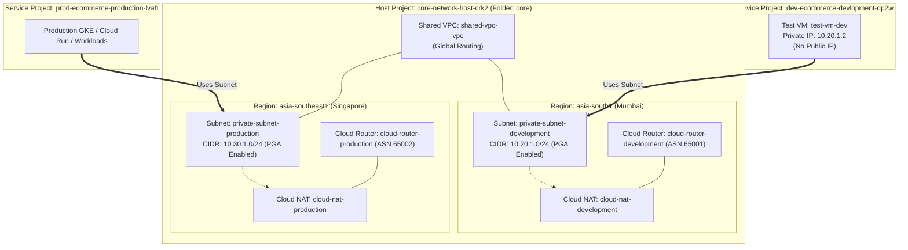

# GCP Landing Zone: Network Infrastructure Phase 1 (Shared VPC, Cloud NAT & Hierarchical Firewalls)

This directory contains the **Network Infrastructure Phase 1** layer for the Google Cloud Landing Zone. It provisions the enterprise Shared VPC network, regional subnets, Cloud Routers, Cloud NAT gateways, Service Project attachments, Subnet IAM delegations, and dual-layer security guardrails (Folder Hierarchical Firewall Policies + VPC Firewall Rules) driven by declarative YAML configurations.

---

## Network Architecture



---

## Live Deployed Resources

| Component | Resource Name | Identifier / CIDR | Region / Project |
| :--- | :--- | :--- | :--- |
| **Host Project** | `network-host` | `core-network-host-crk2` | `folders/982884613697` (`core`) |
| **Shared VPC** | `shared-vpc-vpc` | `projects/core-network-host-crk2/global/networks/shared-vpc-vpc` | Global |
| **Dev Subnet** | `private-subnet-development` | `10.20.1.0/24` (Gateway: `10.20.1.1`) | `asia-south1` |
| **Prod Subnet** | `private-subnet-production` | `10.30.1.0/24` (Gateway: `10.30.1.1`) | `asia-southeast1` |
| **Cloud Router (Dev)** | `cloud-router-development` | ASN `65001` | `asia-south1` |
| **Cloud NAT (Dev)** | `cloud-nat-development` | Auto-allocated NAT IPs | `asia-south1` |
| **Cloud Router (Prod)** | `cloud-router-production` | ASN `65002` (Custom routes) | `asia-southeast1` |
| **Cloud NAT (Prod)** | `cloud-nat-production` | Auto-allocated NAT IPs | `asia-southeast1` |
| **Service Project (Dev)** | `dev-ecommerce-devlopment-dp2w` | Attached to `core-network-host-crk2` | Folder: `development` |
| **Service Project (Prod)**| `prod-ecommerce-production-lvah`| Attached to `core-network-host-crk2` | Folder: `production` |
| **Hierarchical Policy** | `secops-mandatory-guardrails` | Associated to `folders/982884613697` | Global / Folder Scope |

---

## Security Architecture: Dual-Layer Defense

### 1. Hierarchical Firewall Policy (`firewalls.yaml`)
Attached to the `core` folder (`folders/982884613697`), enforcing immutable security guardrails across all sub-resources:

| Priority | Direction | Action | Target / Protocol | Source CIDR | Purpose |
| :--- | :--- | :--- | :--- | :--- | :--- |
| **900** | INGRESS | **ALLOW** | TCP `22` | `35.235.240.0/20` | Identity-Aware Proxy (IAP) SSH tunneling |
| **1000** | INGRESS | **DENY** | TCP `22` (Logged) | `0.0.0.0/0` | Block public SSH from internet |
| **1001** | INGRESS | **DENY** | TCP `3389` (Logged) | `0.0.0.0/0` | Block public RDP from internet |
| **2000** | INGRESS | **ALLOW** | TCP all | `130.211.0.0/22`, `35.191.0.0/16` | Google Cloud Load Balancer & health checks |
| **3000** | INGRESS | **ALLOW** | ALL protocols | `10.0.0.0/8`, `172.16.0.0/12`, `192.168.0.0/16` | Internal RFC1918 cross-subnet traffic |

### 2. VPC Firewall Rules (`network-config.yaml`)
Granular project-level rules within `shared-vpc-vpc`:
* `allow-iap-ssh`: Ingress TCP 22 for VMs tagged `allow-iap-ssh`.
* `allow-health-check`: Ingress TCP 8080 for targets tagged `allow-health-check`.
* `allow-load-balancer`: Ingress TCP 80, 443, 8080 for targets tagged `allow-web`.
* `allow-internet`: Egress TCP 80, 443 to `0.0.0.0/0`.

---

## Subnet IAM Delegations (`shared_vpc.yaml`)

Ensures least-privilege access so service projects can attach workloads to specific host project subnets:

* **`private-subnet-development` (`asia-south1`)**:
  - GKE service agent (`service-<PROJ_NUM>@container-engine-robot.iam.gserviceaccount.com`)
  - CI/CD Deployer SA (`cicd-deployer-sa@dev-ecommerce-devlopment-dp2w.iam.gserviceaccount.com`)
  - Lead Developer (`user:bharath.k@quadrasystems.net`)
* **`private-subnet-production` (`asia-southeast1`)**:
  - GKE and Cloud Run service agents
  - Operations Engineer (`user:vasanthkumar.n@quadrasystems.net`)

---

## Execution Guide

### 1. Initialize and Apply
```powershell
cd d:\GCP-DevOps-WorkSpace\gcp-terraform-best-practices\2-gcp-landing-zone-terraform\2-network-infra-phase-1-vpc-shared-vpc-firewall-policy

# Initialize remote backend and modules
terraform init

# Review execution plan
terraform plan

# Deploy network infrastructure
terraform apply
```

---

## Live End-to-End Verification & Test Results

A live test virtual machine (`test-vm-dev`) was deployed in the service project `dev-ecommerce-devlopment-dp2w` connected to the Shared VPC subnet `private-subnet-development` without any public IP.

### Verification Summary

| Test Case | Command Executed | Observed Result | Status |
| :--- | :--- | :--- | :--- |
| **IAP SSH Access** | `gcloud compute ssh test-vm-dev --project="dev-ecommerce-devlopment-dp2w" --zone="asia-south1-a" --tunnel-through-iap` | SSH connected successfully without public IP. | **PASSED** |
| **Private IP Verification** | `ip -4 addr show ens4` | `inet 10.20.1.2/32 scope global dynamic ens4` | **PASSED** |
| **Outbound Internet via Cloud NAT** | `curl -I https://www.google.com` | `HTTP/2 200` | **PASSED** |
| **Private Google Access (PGA)** | `curl -I https://storage.googleapis.com` | `HTTP/2 400 (UploadServer)` &rarr; Reached Google internal endpoint without traversing the internet. | **PASSED** |

### Raw Test Log Excerpt
```text
yuvaraj_k@test-vm-dev:~$ ip -4 addr show ens4
2: ens4: <BROADCAST,MULTICAST,UP,LOWER_UP> mtu 1460 qdisc mq state UP group default qlen 1000
    altname enp0s4
    inet 10.20.1.2/32 metric 100 scope global dynamic ens4

yuvaraj_k@test-vm-dev:~$ curl -I https://www.google.com
HTTP/2 200 
server: gws

yuvaraj_k@test-vm-dev:~$ curl -I https://storage.googleapis.com
HTTP/2 400 
server: UploadServer
```

---

## File Manifest

* [`main.tf`](./main.tf) — Invokes the modular `vpc-subnet-router-nat-firewall`, `shared-vpc`, and `hierarchical-firewalls` submodules.
* [`network-config.yaml`](./network-config.yaml) — Defines VPC, subnets, routers, NATs, and VPC firewall rules.
* [`shared_vpc.yaml`](./shared_vpc.yaml) — Defines service project attachments and subnet IAM delegations.
* [`firewalls.yaml`](./firewalls.yaml) — Defines folder-level hierarchical firewall policy and priority rules.
* [`provider.tf`](./provider.tf) — GCP provider configuration and GCS state backend (`prefix = "network-phase-1"`).
* [`output.tf`](./output.tf) — Exposes VPC self-links, subnet summaries, NAT configs, and rule summaries.
* [`output.txt`](./output.txt) — Captured live Terraform state outputs.
* [`vm-test-output.txt`](./vm-test-output.txt) — Captured CLI session validating IAP, Cloud NAT, and PGA connectivity.
