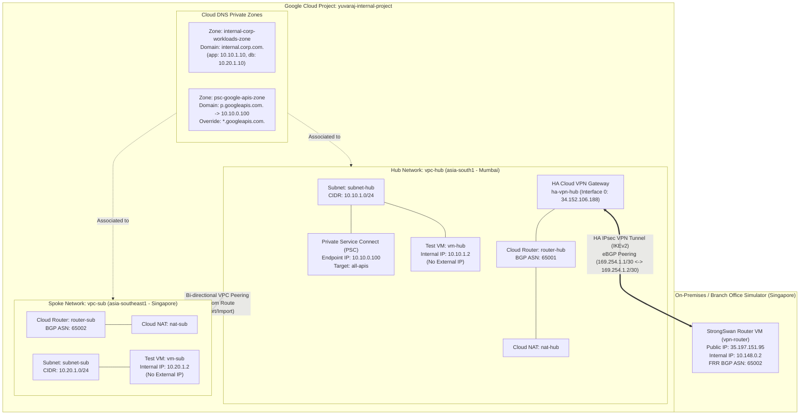

# Phase 2 (Advanced): Network Infrastructure (VPC Peering, Cloud DNS, PSC & HA Cloud VPN)

This directory implements enterprise-grade, advanced hybrid and multi-VPC networking on Google Cloud Platform using Terraform. It establishes a multi-region **Hub-and-Spoke topology**, configures **VPC Network Peering**, enables **Private Service Connect (PSC)** for secure Google API access, sets up private **Cloud DNS** zones for internal service discovery, and deploys high-availability **HA Cloud VPN** with dynamic eBGP routing to an external gateway.

---

## Navigation & Repository Index

- [Root Repository README](../../README.md)
- [Phase 0: Bootstrap & Governance](../0-bootstrap/README.md)
- [Phase 1: Foundation Infrastructure](../1-foundation-infra/README.md)
- [Phase 2: Network Infrastructure Phase 1](../2-network-infra-phase-1-vpc-shared-vpc-firewall-policy/README.md)
- [Module 3: SecOps Infrastructure Testing](../../3-secops-infrastructure-terraform-testing/README.md)

---

## Architecture Topology



---

## Directory Structure

```text
2-network-infra-phase-2-vpc-peering-psc-dns-vpn/
├── README.md                  # Comprehensive Architecture & Deployment Documentation (This file)
├── provider.tf                # Google Provider (~> 6.0) & Project Defaults
├── main.tf                    # Terraform Orchestration invoking 5 Network Modules
├── network.yaml               # VPCs, Subnets, Routers, Cloud NAT, and Firewall Rules
├── peering.yaml               # VPC Network Peering Specification (Hub <-> Spoke)
├── dns.yaml                   # Private DNS Managed Zones & A / CNAME Records
├── psc.yaml                   # Private Service Connect (PSC) Endpoint for Google APIs
├── vpn.yaml                   # HA Cloud VPN Gateway, External Peer Gateway, & BGP Tunnels
├── output.tf                  # Exported Resource Definitions & Outputs
├── output.txt                 # Actual Live Terraform Outputs from Apply
├── testing.md                 # End-to-End Test Commands (IAP, Peering, DNS, PSC)
├── test-out.txt               # Remote StrongSwan VM Provisioning Execution Logs
└── vpn-setup.md               # Complete One-Shot Setup Script for StrongSwan & FRRouting
```

---

## Components & Technical Specifications

### 1. Multi-VPC Architecture ([`network.yaml`](./network.yaml))
* **Hub Network (`vpc-hub`)**:
  * Region: `asia-south1` (Mumbai).
  * Subnet: `subnet-hub` with primary CIDR `10.10.1.0/24` and Private Google Access (PGA) enabled.
  * Cloud Router: `router-hub` (BGP ASN: `65001`).
  * Cloud NAT: `nat-hub` with automated IP allocation for private egress.
  * Firewalls: Allows internal RFC1918 traffic (`10.0.0.0/8`), IAP SSH (`35.235.240.0/20`), and outbound internet.
* **Spoke Network (`vpc-sub`)**:
  * Region: `asia-southeast1` (Singapore).
  * Subnet: `subnet-sub` with primary CIDR `10.20.1.0/24` and Private Google Access enabled.
  * Cloud Router: `router-sub` (BGP ASN: `65002`).
  * Cloud NAT: `nat-sub` for egress.
  * Firewalls: Matches hub security posture.

### 2. Bi-Directional VPC Peering ([`peering.yaml`](./peering.yaml))
Connects `vpc-hub` and `vpc-sub` privately across Google's global backbone without traversing the public internet:
* **Forward Peering**: `peering-hub-to-sub` (`vpc-hub` $\to$ `vpc-sub`).
* **Reverse Peering**: `peering-sub-to-hub` (`vpc-sub` $\to$ `vpc-hub`).
* **Route Exchange**: `export_custom_routes = true` and `import_custom_routes = true` enabled on both ends to allow cross-VPC propagation of dynamic routes learned via Cloud Routers and VPN.
* **Status**: `ACTIVE` (Connected).

### 3. Private Cloud DNS Managed Zones ([`dns.yaml`](./dns.yaml))
Provides internal name resolution across both VPC networks without exposing records publicly:
* **Workload Discovery Zone (`internal-corp-workloads-zone`)**:
  * DNS Name: `internal.corp.com.`
  * Visibility: Private (bound to `vpc-hub` and `vpc-sub`).
  * Records:
    * `app.internal.corp.com.` $\to$ `10.10.1.10` (A)
    * `db.internal.corp.com.` $\to$ `10.20.1.10` (A)
    * `web.internal.corp.com.` $\to$ CNAME to `app.internal.corp.com.`
* **Google APIs PSC Zone (`psc-google-apis-zone`)**:
  * DNS Name: `p.googleapis.com.`
  * Records:
    * `p.googleapis.com.` $\to$ `10.10.0.100` (A)
    * `*.p.googleapis.com.` $\to$ CNAME to `p.googleapis.com.`

### 4. Private Service Connect (PSC) for Google APIs ([`psc.yaml`](./psc.yaml))
* **Endpoint Name**: `pscapishub`
* **Internal IP Address**: `10.10.0.100` (reserved in `vpc-hub`)
* **Target Bundle**: `all-apis`
* **Security & Isolation**: Allows instances in `vpc-hub` (and peered VPCs) to access Google Cloud services (such as Cloud Storage, BigQuery, Pub/Sub, KMS) privately without public IPs or NAT egress.

### 5. High-Availability (HA) Cloud VPN ([`vpn.yaml`](./vpn.yaml))
Connects Google Cloud directly to an external simulated on-premises / branch office router:
* **GCP HA VPN Gateway**: `ha-vpn-hub` located in `asia-south1`.
  * Interface 0 Public IP: `34.152.106.188`
  * Interface 1 Public IP: `34.177.35.104`
* **External Peer Gateway**: `peer-strongswan-router`
  * Redundancy Type: `SINGLE_IP_INTERNALLY_REDUNDANT`
  * Interface 0 Public IP: `35.197.151.95`
* **BGP Session & IPsec Tunnel**:
  * Tunnel: `ha-vpn-hub-tunnel-0` (IKEv2, AES-256-GCM / SHA-256)
  * Pre-Shared Key (PSK): Secure custom shared secret
  * Link-Local BGP Subnet: `169.254.1.0/30`
  * GCP BGP IP: `169.254.1.1` (ASN `65001`)
  * Remote Peer BGP IP: `169.254.1.2` (ASN `65002`)

---

## Live Deployment Output Matrix

Verified from [`output.txt`](./output.txt):

| Resource / Category | Resource Name | Key Attributes / Values | State |
| :--- | :--- | :--- | :--- |
| **Hub VPC** | `vpc-hub` | CIDR `10.10.1.0/24`, Region: `asia-south1` | ACTIVE |
| **Spoke VPC** | `vpc-sub` | CIDR `10.20.1.0/24`, Region: `asia-southeast1` | ACTIVE |
| **VPC Peering** | `peering-hub-to-sub` | Local-to-Peer (`vpc-hub` $\to$ `vpc-sub`), Custom Routes Export/Import | ACTIVE |
| **VPC Peering** | `peering-sub-to-hub` | Peer-to-Local (`vpc-sub` $\to$ `vpc-hub`), Custom Routes Export/Import | ACTIVE |
| **Cloud NAT (Hub)** | `nat-hub` | Region: `asia-south1`, Attached to `router-hub` | ACTIVE |
| **Cloud NAT (Spoke)** | `nat-sub` | Region: `asia-southeast1`, Attached to `router-sub` | ACTIVE |
| **Cloud DNS Zone** | `internal-corp-workloads-zone` | Private zone `internal.corp.com.`, Bound to both VPCs | ACTIVE |
| **Cloud DNS Zone** | `psc-google-apis-zone` | Private zone `p.googleapis.com.`, Points to `10.10.0.100` | ACTIVE |
| **PSC Endpoint** | `pscapishub` | Forwarding Rule for `all-apis`, IP: `10.10.0.100` | ACTIVE |
| **HA VPN Gateway** | `ha-vpn-hub` | Interfaces: `34.152.106.188` (if0), `34.177.35.104` (if1) | ACTIVE |
| **External VPN Gateway**| `peer-strongswan-router` | Remote IP: `35.197.151.95` | ACTIVE |
| **Cloud Router BGP** | `router-hub` | ASN `65001`, Interface `169.254.1.1/30`, Peer `169.254.1.2` (ASN `65002`)| ACTIVE |

---

## On-Premises StrongSwan Router Simulation

To validate enterprise hybrid connectivity without requiring physical data center hardware, a Debian/Ubuntu Compute Engine instance acts as the remote branch router:

1. **Provisioned Remote VM (`vpn-router`)** in `asia-southeast1-a` with static external IP `35.197.151.95` and internal IP `10.148.0.2` (documented in [`test-out.txt`](./test-out.txt)).
2. **Firewall Permitted**: UDP ports `500`, `4500`, TCP port `179` (BGP), ESP, and ICMP.
3. **Automated Configuration** via [`vpn-setup.md`](./vpn-setup.md):
   * **IPsec Engine**: StrongSwan with IKEv2 and VTI (`vti0` tunnel interface).
   * **Dynamic Routing**: FRRouting (`frr`) running BGP daemon with ASN `65002`.
   * **Kernel Tuning**: Enabled `net.ipv4.ip_forward=1`, disabled reverse path filtering (`rp_filter=0`), and clamped TCP MSS to PMTU (`1400`).

---

## Verification & Testing Playbook

Follow these test steps (documented in [`testing.md`](./testing.md)) from private instances:

### 1. Provision Ephemeral Test VMs
```bash
# VM 1: Inside Hub VPC (Mumbai)
gcloud compute instances create vm-hub \
    --project="yuvaraj-internal-project" \
    --zone="asia-south1-a" \
    --machine-type="e2-micro" \
    --image-family="debian-12" \
    --image-project="debian-cloud" \
    --network-interface="subnet=projects/yuvaraj-internal-project/regions/asia-south1/subnetworks/subnet-hub,no-address" \
    --tags="allow-iap-ssh"

# VM 2: Inside Spoke VPC (Singapore)
gcloud compute instances create vm-sub \
    --project="yuvaraj-internal-project" \
    --zone="asia-southeast1-a" \
    --machine-type="e2-micro" \
    --image-family="debian-12" \
    --image-project="debian-cloud" \
    --network-interface="subnet=projects/yuvaraj-internal-project/regions/asia-southeast1/subnetworks/subnet-sub,no-address" \
    --tags="allow-iap-ssh"
```

### 2. Connect via IAP Tunneling
```bash
gcloud compute ssh vm-hub \
    --project="yuvaraj-internal-project" \
    --zone="asia-south1-a" \
    --tunnel-through-iap
```

### 3. Run Validation Tests (Inside `vm-hub`)

#### Test A: Cross-VPC Peering Connectivity
```bash
# Ping Spoke VM (10.20.1.2) across regions over VPC Peering
ping -c 4 10.20.1.2
```
*Expected Result*: Round-trip ping success (~30-35ms cross-region latency between Mumbai and Singapore) proving active VPC Peering.

#### Test B: Cloud DNS Internal Resolution
```bash
nslookup app.internal.corp.com
nslookup db.internal.corp.com
```
*Expected Result*: Resolves immediately to `10.10.1.10` and `10.20.1.10` via Cloud DNS private resolver (`169.254.169.254`).

#### Test C: Cloud NAT Internet Egress
```bash
curl -I https://www.google.com
```
*Expected Result*: `HTTP/2 200` received without having an external IP assigned.

#### Test D: Private Service Connect (PSC) Access to Google APIs
```bash
# 1. DNS check for custom PSC domain
nslookup storage.p.googleapis.com

# 2. HTTPS reachability over private PSC endpoint
curl -I https://storage.p.googleapis.com
```
*Expected Result*: Resolves to `10.10.0.100` and returns an HTTP response directly from Google's private service frontend without touching the public internet.

---

## How to Apply

```powershell
# Navigate to Phase 2 directory
cd d:\GCP-DevOps-WorkSpace\gcp-terraform-best-practices\2-gcp-landing-zone-terraform\2-network-infra-phase-2-vpc-peering-psc-dns-vpn

# Initialize Terraform modules and provider
terraform init

# Review execution plan
terraform plan

# Apply infrastructure changes
terraform apply
```

---

## Next Steps: Security Operations & Zero-Trust

Proceed to **Module 3: SecOps Infrastructure & Zero-Trust Cloud Security Testing**:
- [Module 3: SecOps Infrastructure Testing](../../3-secops-infrastructure-terraform-testing/README.md)
