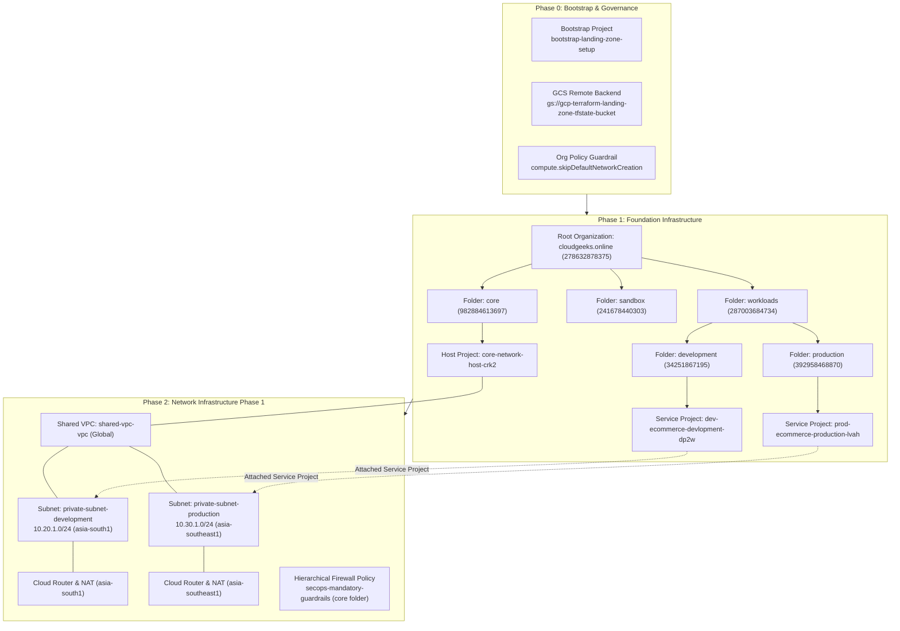

# Google Cloud Landing Zone with Terraform

This repository implements an enterprise-grade, modular **Google Cloud Platform (GCP) Landing Zone** following the Google Cloud Architecture Framework, CIS Benchmarks, and infrastructure-as-code (IaC) best practices.

---

## Directory Structure & Documentation Index

```text
2-gcp-landing-zone-terraform/
├── README.md                                                        # Root Landing Zone Architecture & Index
├── 0-bootstrap/
│   ├── 1-IAM-Policy.md                                              # Prerequisites & IAM Permissions
│   └── 2-bootstrap-project.md                                        # Bootstrap Project, GCS State & Troubleshooting
├── 1-foundation-infra/
│   ├── README.md                                                    # Foundation Phase: Org, Folders, Projects & Tags
│   ├── foundation.yaml                                              # Declarative Foundation Specification
│   ├── main.tf                                                      # Module Call (git custom module)
│   ├── provider.tf                                                  # GCS Remote Backend (prefix = "foundation")
│   ├── output.tf                                                    # Folder, Project, and Tag Outputs
│   └── output.txt                                                   # Live State Outputs
└── 2-network-infra-phase-1-vpc-shared-vpc-firewall-policy/
    ├── README.md                                                    # Network Phase 1: Shared VPC, NAT & Firewalls
    ├── network-config.yaml                                          # VPC, Subnets, Cloud Routers, Cloud NAT & VPC Rules
    ├── shared_vpc.yaml                                              # Host/Service Attachments & Subnet IAM
    ├── firewalls.yaml                                               # Folder Hierarchical Firewall Policy
    ├── main.tf                                                      # Multi-Module Composition
    ├── provider.tf                                                  # GCS Remote Backend (prefix = "network-phase-1")
    ├── output.tf                                                    # Network & Security Policy Outputs
    ├── output.txt                                                   # Live State Network Outputs
    └── vm-test-output.txt                                           # Live End-to-End Test & Verification Log
```

---

## Architecture Overview



---

## Live Environment Summary

| Component | Identifier | Details / Location |
| :--- | :--- | :--- |
| **Root Organization** | `278632878375` | `cloudgeeks.online` |
| **Billing Account** | `012D91-0F6EE1-44CE12` | Quadra GCP Master Billing Account |
| **Bootstrap Project** | `bootstrap-landing-zone-setup` | Management & Quota project |
| **Terraform Remote State** | `gcp-terraform-landing-zone-tfstate-bucket` | GCS Bucket (`asia-south1`) with UBLA & Versioning |
| **Network Host Project** | `core-network-host-crk2` | Folder: `core` (`folders/982884613697`) |
| **Development Project** | `dev-ecommerce-devlopment-dp2w` | Folder: `development` (`folders/34251867195`) |
| **Production Project** | `prod-ecommerce-production-lvah` | Folder: `production` (`folders/392958468870`) |
| **Shared VPC** | `shared-vpc-vpc` | Global Routing in `core-network-host-crk2` |
| **Dev Subnet** | `private-subnet-development` | `10.20.1.0/24` (PGA Enabled, `asia-south1`) |
| **Prod Subnet** | `private-subnet-production` | `10.30.1.0/24` (PGA Enabled, `asia-southeast1`) |
| **Hierarchical Firewall Policy** | `secops-mandatory-guardrails` | Associated to `folders/982884613697` |

---

## Phase Breakdown & Execution Sequence

### [Phase 0: Bootstrap Setup](./0-bootstrap/2-bootstrap-project.md)
* Setup guide: [`0-bootstrap/2-bootstrap-project.md`](./0-bootstrap/2-bootstrap-project.md)
* Prerequisites & IAM roles: [`0-bootstrap/1-IAM-Policy.md`](./0-bootstrap/1-IAM-Policy.md)
* Provisions the bootstrap project, remote GCS state bucket, and enables foundational APIs.

### [Phase 1: Foundation Infrastructure](./1-foundation-infra/README.md)
* Detailed guide: [`1-foundation-infra/README.md`](./1-foundation-infra/README.md)
* Provisions top-level folders (`core`, `workloads`, `sandbox`), sub-folders (`development`, `production`), dynamic projects with random suffixes, resource tags, and org policies.

```powershell
cd 1-foundation-infra
terraform init
terraform plan
terraform apply
```

### [Phase 2: Network Infrastructure Phase 1](./2-network-infra-phase-1-vpc-shared-vpc-firewall-policy/README.md)
* Detailed guide: [`2-network-infra-phase-1-vpc-shared-vpc-firewall-policy/README.md`](./2-network-infra-phase-1-vpc-shared-vpc-firewall-policy/README.md)
* Provisions the Shared VPC in `core-network-host-crk2`, creates regional subnets, sets up Cloud NAT for private internet egress, attaches service projects, delegates subnet IAM, and applies hierarchical security policies.

```powershell
cd 2-network-infra-phase-1-vpc-shared-vpc-firewall-policy
terraform init
terraform plan
terraform apply
```

---

## End-to-End Verification & Validation

The network infrastructure was tested and verified using a private Compute Engine instance (`test-vm-dev`) deployed in the service project `dev-ecommerce-devlopment-dp2w` attached to the Host Project's Shared VPC:

| Test Case | Command | Result | Verification Status |
| :--- | :--- | :--- | :--- |
| **IAP SSH Tunneling** | `gcloud compute ssh test-vm-dev --tunnel-through-iap` | Connected to private VM without public IP | **PASSED** |
| **Shared Subnet Allocation** | `ip -4 addr show ens4` | IP assigned from `10.20.1.0/24` (`10.20.1.2`) | **PASSED** |
| **Cloud NAT Egress** | `curl -I https://www.google.com` | `HTTP/2 200` via Cloud NAT | **PASSED** |
| **Private Google Access** | `curl -I https://storage.googleapis.com` | Reached Google API backend without internet | **PASSED** |

Full verification logs are documented in [`2-network-infra-phase-1-vpc-shared-vpc-firewall-policy/vm-test-output.txt`](./2-network-infra-phase-1-vpc-shared-vpc-firewall-policy/vm-test-output.txt).

---

## Common Deployment Issues Reference

For detailed troubleshooting, see [`0-bootstrap/2-bootstrap-project.md`](./0-bootstrap/2-bootstrap-project.md#common-deployment-issues--troubleshooting).

| Issue | Root Cause | Solution |
| :--- | :--- | :--- |
| **Quota Project 403 (`SERVICE_DISABLED`)** | Org APIs (`cloudresourcemanager`, `orgpolicy`, `essentialcontacts`) disabled in quota project. | Enable all foundational APIs on `bootstrap-landing-zone-setup` via `gcloud services enable` and wait 1-2 mins. |
| **`Cannot destroy project as deletion_policy is set to PREVENT`** | Project failed halfway and became tainted; `lien: true` blocks destroy. | Run `terraform untaint 'module.foundation_infrastructure.google_project.projects["<PROJECT_KEY>"]'` to restore healthy state. |
| **Firewall Deletion 403 (`compute.firewalls.delete`)** | `auto_create_network = false` tries to delete default firewall rules without permissions. | Enable `orgpolicy.googleapis.com` so Terraform applies `compute.skipDefaultNetworkCreation` Org Policy automatically. |
| **IAM Policy (`User ...+demo@... does not exist`)** | `+demo` alias used under `organization_iam`, `top_level_folders`, or `projects.iam`. | Use aliases only under `essential_contacts`; all IAM members must be registered Cloud Identity accounts. |
| **Invalid Project Label (`invalid project label`)** | Spaces in label values (e.g. `management: "network team"`). | Replace spaces with hyphens or underscores (e.g. `management: "network-team"`). |
