# Module 3: SecOps Infrastructure & Zero-Trust Cloud Security Testing

This module implements an enterprise-grade, defense-in-depth **Security Operations (SecOps)** and **Zero-Trust Architecture** on Google Cloud Platform using Terraform. 

Driven declaratively by clean YAML configurations, it leverages reusable, production-ready modules from the custom module registry [`yuva-cloud-devops/gcp-terraform-custom-modules`](https://github.com/yuva-cloud-devops/gcp-terraform-custom-modules) to provision and test 7 foundational security engineering domains.

---

## SecOps Architecture Overview

```mermaid
flowchart TD
    subgraph SecOps["SecOps & Zero-Trust Architecture (yuvaraj-internal-project)"]
        
        subgraph Layer1["1. Identity & Zero-Trust Access"]
            WIF["Workload Identity Federation\n(GitHub Actions OIDC)"]
            IAP["IAP TCP Tunneling\n(Zero-Public-IP VM Access)"]
        end

        subgraph Layer2["2. Edge Protection & Threat Inspection"]
            Armor["Cloud Armor WAF\n(OWASP Core Ruleset & SQLi)"]
            IDS["Cloud IDS\n(Deep Packet Inspection Endpoint)"]
            VPC_SC["VPC Service Controls\n(Data Exfiltration Perimeter)"]
        end

        subgraph Layer3["3. Cryptography & Secrets Management"]
            KMS["Cloud KMS KeyRings & CMEK\n(Automatic 90-Day Rotation)"]
            SM["Secret Manager\n(CMEK Encrypted DB Passwords)"]
        end

        subgraph Layer4["4. PKI & Sensitive Data Governance"]
            CAS["Private Certificate Authority (CAS)\n(DevOps Subordinate/Root CA)"]
            CertMgr["Certificate Manager\n(Edge HTTPS Maps)"]
            DLP["Cloud DLP\n(PII Inspection & Masking Templates)"]
        end

        subgraph Layer5["5. Container Security & Supply Chain"]
            Grafeas["Container Analysis (Grafeas)\n(Attestation Notes)"]
            BinAuth["Binary Authorization\n(Admission Policy & Attestors)"]
        end

        subgraph Layer6["6. Threat Posture & Asset Governance"]
            SCC["Security Command Center (SCC v2)\n(Real-Time Threat Notifications)"]
            CAI["Cloud Asset Inventory (CAI)\n(Real-Time Resource Drift Feeds)"]
        end

        subgraph Layer7["7. Audit Logging & Compliance"]
            Audit["Data Access Audit Logs\n(Admin, Read, Write)"]
            Sinks["Centralized Log Sinks\n(GCS WORM, BigQuery, Pub/Sub SIEM)"]
            CIS["CIS Benchmark Security Metrics\n(Controls 2.4 - 2.12)"]
        end
    end

    Layer1 --> Layer2 --> Layer3 --> Layer4 --> Layer5 --> Layer6 --> Layer7
```



---

## Security Domains & Submodules Index

| # | Security Domain Directory | Primary GCP Services | Key Security Controls & Capabilities |
| :-: | :--- | :--- | :--- |
| **1** | [**`audit-compliance/`**](./audit-compliance/README.md) | Cloud Logging, BigQuery, GCS, Pub/Sub | Centralized security log sinks, WORM immutable storage retention, BigQuery threat analytics dataset, SIEM Pub/Sub stream, and CIS Benchmark v3 controls 2.4–2.12. |
| **2** | [**`container-security/`**](./container-security/README.md) | Binary Authorization, Container Analysis (Grafeas) | Supply chain security, cryptographically signed vulnerability attestations, and deploy-time admission enforcement policies for GKE. |
| **3** | [**`crypto-secrets/`**](./crypto-secrets/README.md) | Cloud KMS, Secret Manager | Customer-Managed Encryption Keys (CMEK) with automated 90-day key rotation, CMEK-encrypted Secret Manager secrets, and least-privilege IAM access. |
| **4** | [**`edge-security/`**](./edge-security/README.md) | Cloud Armor, Cloud IDS, VPC Service Controls | Edge WAF protecting against OWASP Top 10 (SQLi, XSS), Cloud IDS deep packet inspection, and VPC Service Controls security perimeters preventing data exfiltration. |
| **5** | [**`pki-data-security/`**](./pki-data-security/README.md) | Certificate Authority Service (CAS), Cert Manager, Cloud DLP | Internal Private CA hierarchies for mTLS, Certificate Manager maps, and Cloud DLP automated PII scanning & character masking templates. |
| **6** | [**`threat-posture/`**](./threat-posture/README.md) | Security Command Center (SCC v2), Cloud Asset Inventory | Real-time Pub/Sub alerts for active High/Critical SCC findings, and Cloud Asset Inventory event feeds tracking infrastructure configuration drift. |
| **7** | [**`zero-trust-security/`**](./zero-trust-security/README.md) | Workload Identity Federation (WIF), IAM, IAP | Keyless CI/CD authentication via GitHub Actions OIDC (zero static JSON keys), and Identity-Aware Proxy (IAP) TCP forwarding for bastion-less VM access. |

---

## Directory Structure

```text
3-secops-infrastructure-terraform-testing/
├── README.md                                       # Master SecOps Architecture & Index (This File)
│
├── audit-compliance/                               # Domain 1: Audit Logging & CIS Compliance
│   ├── README.md                                   # Audit Architecture, Sinks, & CIS Metrics Guide
│   ├── audit-compliance.yaml                       # YAML Config (Buckets, BigQuery, Sinks & CIS Metrics)
│   ├── main.tf                                     # Module Call (audit-compliance-infra)
│   └── output.txt                                  # Live Deployment Outputs
│
├── container-security/                             # Domain 2: Container Security & Supply Chain
│   ├── README.md                                   # Grafeas Attestations & Admission Policy Guide
│   ├── container-security.yaml                     # YAML Config (Notes, Attestors & Policy Rules)
│   └── main.tf                                     # Module Call (container-security-infra)
│
├── crypto-secrets/                                 # Domain 3: Cryptography & Secrets Management
│   ├── README.md                                   # KMS CMEK & Secret Manager Guide
│   ├── crypto-secrets-minimal.yaml                 # YAML Config (KeyRings, Keys, Secrets & IAM)
│   └── main.tf                                     # Module Call (crypto-secrets-infra)
│
├── edge-security/                                  # Domain 4: Edge Defense & Threat Inspection
│   ├── README.md                                   # Cloud Armor WAF, Cloud IDS & VPC-SC Guide
│   ├── edge-security.yaml                          # YAML Config (Armor Rules, IDS & Perimeters)
│   └── main.tf                                     # Module Call (edge-security-infra)
│
├── pki-data-security/                              # Domain 5: PKI & Sensitive Data Governance
│   ├── README.md                                   # Private CAS, Cert Manager & DLP Guide
│   ├── pki-data-security.yaml                      # YAML Config (CA Pool, Root CA, Maps & DLP)
│   └── main.tf                                     # Module Call (pki-data-security-infra)
│
├── threat-posture/                                 # Domain 6: Threat Posture & Asset Drift
│   ├── README.md                                   # SCC v2 Notifications & Asset Drift Guide
│   ├── threat-posture.yaml                         # YAML Config (SCC Filters, Pub/Sub & Feeds)
│   └── main.tf                                     # Module Call (threat-posture-infra)
│
└── zero-trust-security/                            # Domain 7: Zero-Trust Identity & Access
    ├── README.md                                   # WIF Keyless CI/CD & IAP Tunneling Guide
    ├── zero-trust.yaml                             # YAML Config (WIF Pool, Provider, SA & IAP)
    └── main.tf                                     # Module Call (zero-trust-security-infra)
```

---

## Design Principles

1. **Declarative YAML-Driven Infrastructure**:
   All security modules separate **logic (Terraform HCL)** from **policy intent (YAML specifications)**. Platform and security engineers can audit, review, and adjust policies in plain YAML without touching underlying Terraform code.
2. **Immutable Governance & WORM Retention**:
   Audit logs are exported to immutable Cloud Storage buckets configured with Object Versioning and Write Once, Read Many (WORM) retention periods to satisfy regulatory compliance (SOC 2, ISO 27001, HIPAA).
3. **Keyless Zero-Trust CI/CD**:
   Completely eliminates high-risk long-lived Service Account keys (`.json`) by using **Workload Identity Federation (WIF)** with OpenID Connect (OIDC) token exchange from GitHub Actions.
4. **Zero-Public-IP Network Posture**:
   Administrative access is strictly brokered through Google's Identity-Aware Proxy (IAP) over TCP forwarding (`35.235.240.0/20`), completely closing public SSH (`22`) and RDP (`3389`) attack surfaces.
5. **Continuous Supply Chain Attestation**:
   Container workloads deployed to Kubernetes must pass cryptographic attestation checks (via Binary Authorization and Grafeas Container Analysis) before admission into production clusters.
6. **Defense in Depth**:
   Combines perimeter edge defenses (Cloud Armor WAF, Cloud IDS, VPC-SC) with internal data governance (Customer-Managed Encryption Keys in KMS, Secret Manager, Cloud DLP inspection and masking).

---

## Module Deployment & Testing Guide

Each submodule in this directory operates as an independent, self-contained Terraform root configuration targeting the test project `yuvaraj-internal-project` in `asia-south1`.

### Prerequisites

```powershell
# Authenticate and set the active project
gcloud auth login
gcloud auth application-default login
gcloud config set project yuvaraj-internal-project
gcloud auth application-default set-quota-project yuvaraj-internal-project
```

### Execution Pattern

To test any security submodule:

```powershell
# Navigate into the desired submodule directory (e.g., container-security)
cd d:\GCP-DevOps-WorkSpace\gcp-terraform-best-practices\3-secops-infrastructure-terraform-testing\container-security

# Initialize Terraform and download the custom module from GitHub
terraform init

# Validate configuration syntax
terraform validate

# Inspect the planned security resources
terraform plan

# Deploy security infrastructure
terraform apply
```

---

## Compliance & Standards Mapping

| Standard / Framework | Control Area | Implemented Submodule |
| :--- | :--- | :--- |
| **CIS GCP Benchmark v3** | 2.4 - 2.12 Logging & Monitoring | [`audit-compliance/`](./audit-compliance/README.md) |
| **NIST SP 800-190** | Container Build & Deploy Security | [`container-security/`](./container-security/README.md) |
| **NIST SP 800-57** | Cryptographic Key Management | [`crypto-secrets/`](./crypto-secrets/README.md) |
| **OWASP Top 10 (2021)** | Injection & Broken Access Control | [`edge-security/`](./edge-security/README.md) |
| **GDPR / CCPA / HIPAA** | PII Identification & Protection | [`pki-data-security/`](./pki-data-security/README.md) |
| **MITRE ATT&CK Cloud** | Threat Detection & Drift Monitoring | [`threat-posture/`](./threat-posture/README.md) |
| **NIST SP 800-207** | Zero Trust Architecture | [`zero-trust-security/`](./zero-trust-security/README.md) |

---

## Navigation & Cross References

- [Root Repository README](../README.md)
- [Module 0: Competency & Capability Matrix](../0-gcp-services-by-terraform/Readme.md)
- [Module 1: Reverse Terraform (Import Guide)](../1-reverse-terraform/README.md)
- [Module 2: Enterprise GCP Landing Zone](../2-gcp-landing-zone-terraform/README.md)
- [Module 4: Storage Infrastructure Testing](../4-storage-infrastructure-terraform-testing/README.md)
- [Module 5: Database Infrastructure Testing](../5-database-infrastructure-terraform-testing/README.md)
- [Module 6: Compute & Availability Testing](../6-compute-availability-infrastructure-terraform-testing/README.md)
- [Module 7: Containers Infrastructure Testing](../7-containers-infrastructure-terraform-testing/README.md)
- [Module 8: Serverless Infrastructure Testing](../8-serverless-infrastructure-terraform-testing/README.md)
