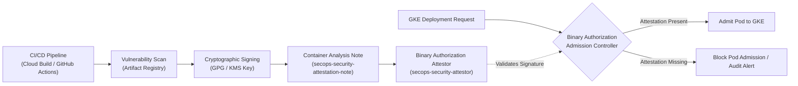

# SecOps Domain 2: Container Security & Supply Chain Defense

This directory implements Google Cloud **Binary Authorization** and **Container Analysis (Grafeas)** to enforce software supply chain security and deploy-time admission control for Google Kubernetes Engine (GKE) and Cloud Run.

---

## Supply Chain Security Architecture



---

## Configuration Breakdown

Driven declaratively by [`container-security.yaml`](./container-security.yaml):

### 1. Container Analysis (Grafeas) Notes
* **Note Name**: `secops-security-attestation-note`
* **Role**: Acts as the centralized metadata anchor in Google Cloud's Grafeas implementation. Certifies that a container image has successfully completed CI/CD security scanning, static code analysis, and vulnerability checks.

### 2. Binary Authorization Attestors
* **Attestor Name**: `secops-security-attestor`
* **Note Reference**: `secops-security-attestation-note`
* **Role**: The trusted verification authority responsible for validating digital signatures attached to container images before deployment.

### 3. Deploy-Time Admission Policy
* **Global Evaluation Mode**: `ENABLE`
* **Admission Whitelist Patterns**:
  * `gcr.io/google_containers/*`
  * `k8s.gcr.io/*`
  * `gke.gcr.io/*`
  * `gcr.io/stackdriver-agents/*`
* **Default Admission Rule**:
  * **Evaluation Mode**: `REQUIRE_ATTESTATION` (demands valid cryptographic signature from `secops-security-attestor`).
  * **Enforcement Mode**: `DRYRUN_AUDIT_LOG_ONLY` (safely audits admission violations in Cloud Audit Logs before blocking production workloads).

---

## File Manifest

* [`main.tf`](./main.tf) — Invokes `git::https://github.com/yuva-cloud-devops/gcp-terraform-custom-modules.git//secops-infrastructure/container-security-infra?ref=main`.
* [`container-security.yaml`](./container-security.yaml) — Declarative YAML specification for notes, attestors, and admission policies.

---

## Execution Guide

```powershell
cd d:\GCP-DevOps-WorkSpace\gcp-terraform-best-practices\3-secops-infrastructure-terraform-testing\container-security

# Initialize Terraform modules
terraform init

# Validate YAML and HCL syntax
terraform validate

# Inspect changes
terraform plan

# Apply container security policy
terraform apply
```

---

## Verification Commands

```powershell
# Inspect the active Binary Authorization policy
gcloud container binauthz policy export --project=yuvaraj-internal-project

# List registered attestors
gcloud container binauthz attestors list --project=yuvaraj-internal-project

# Check Container Analysis notes
gcloud container analysis notes list --project=yuvaraj-internal-project
```
