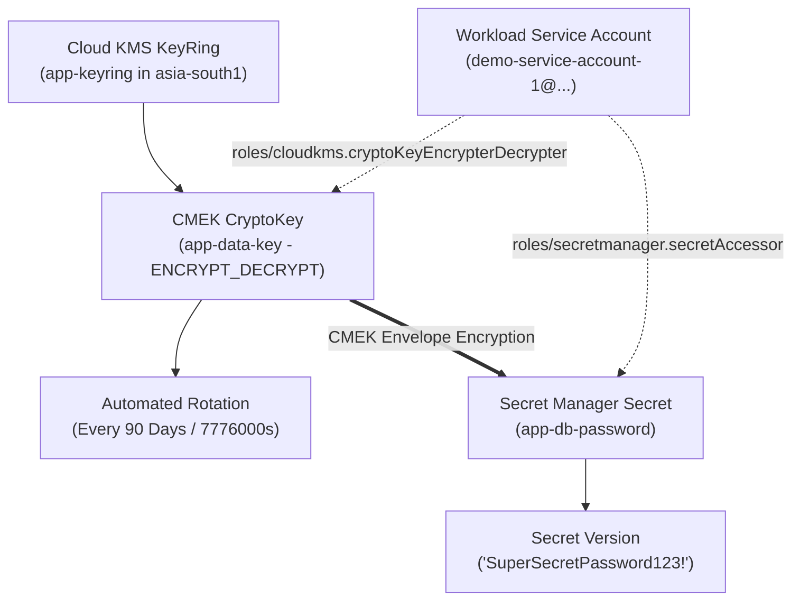

# SecOps Domain 3: Cryptography & Secrets Management

This directory implements enterprise cryptographic key management using **Cloud Key Management Service (Cloud KMS)** and centralized secrets management using **Secret Manager**, integrating **Customer-Managed Encryption Keys (CMEK)** and automated key rotation.

---

## Cryptographic Architecture



---

## Components & Technical Specifications

Driven declaratively by [`crypto-secrets-minimal.yaml`](./crypto-secrets-minimal.yaml):

### 1. Cloud KMS KeyRings & CMEK Keys
* **KeyRing**: `app-keyring` (Location: `asia-south1`).
* **CryptoKey**: `app-data-key`
  * Purpose: `ENCRYPT_DECRYPT` (Symmetric encryption using AES-256-GCM).
  * Automated Rotation: `7776000s` (90 days), complying with CIS Benchmark 1.10 and NIST SP 800-57 guidelines.
  * IAM Binding: Grants `roles/cloudkms.cryptoKeyEncrypterDecrypter` to authorized application service accounts.

### 2. CMEK-Encrypted Secret Manager
* **Secret Identifier**: `app-db-password`
* **Replication**: User-managed in `asia-south1`.
* **CMEK Encryption**: Encrypted at rest using `app-keyring/app-data-key` (envelope encryption).
* **Payload**: Parameterized initial secret payload (`SuperSecretPassword123!`).
* **Least-Privilege Access**: Grants `roles/secretmanager.secretAccessor` strictly to runtime workload service accounts.

---

## File Manifest

* [`main.tf`](./main.tf) — Invokes `git::https://github.com/yuva-cloud-devops/gcp-terraform-custom-modules.git//secops-infrastructure/crypto-secrets-infra?ref=main`.
* [`crypto-secrets-minimal.yaml`](./crypto-secrets-minimal.yaml) — Declarative YAML specification for KMS keyrings, crypto keys, secret containers, versions, and IAM bindings.

---

## Execution Guide

```powershell
cd d:\GCP-DevOps-WorkSpace\gcp-terraform-best-practices\3-secops-infrastructure-terraform-testing\crypto-secrets

# Initialize Terraform modules
terraform init

# Validate configuration
terraform validate

# Review deployment plan
terraform plan

# Apply cryptography and secrets infrastructure
terraform apply
```

---

## Verification Commands

```powershell
# List KMS KeyRings and Keys
gcloud kms keyrings list --location=asia-south1 --project=yuvaraj-internal-project
gcloud kms keys list --keyring=app-keyring --location=asia-south1 --project=yuvaraj-internal-project

# Verify Secret Manager secret details and CMEK binding
gcloud secrets describe app-db-password --project=yuvaraj-internal-project

# Access secret payload (if authorized)
gcloud secrets versions access latest --secret=app-db-password --project=yuvaraj-internal-project
```
