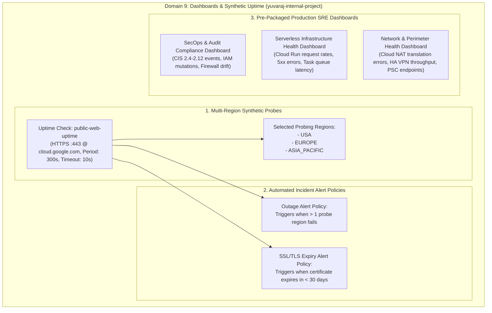

# Domain 9: Dashboards & Synthetic Uptime Infrastructure

This module provisions **Multi-Region Synthetic Uptime Checks, Automated Certificate Expiry Alerts, and Pre-Packaged Observability Dashboards** for Google Cloud Platform using Terraform. It establishes global availability probing, automated incident alerting for outages and impending SSL/TLS certificate expirations, and ready-to-use SRE dashboards across SecOps, Serverless, and Network perimeters via declarative YAML configuration.

Driven by the custom module [`dashboards-uptime-infra`](https://github.com/yuva-cloud-devops/gcp-terraform-custom-modules) in [`yuva-cloud-devops/gcp-terraform-custom-modules`](https://github.com/yuva-cloud-devops/gcp-terraform-custom-modules), it targets `yuvaraj-internal-project`.

---

## Observability & Uptime Architecture



---

## Technical Specifications & Capabilities

| Capability | Component Name | Technical Specification | Operational & Observability Value |
| :--- | :--- | :--- | :--- |
| **Synthetic Uptime Probes** | `public-web-uptime` | Cloud Monitoring synthetic HTTPS probe targeting `cloud.google.com:443/`, 300s period, 10s timeout, probing across USA, Europe, and Asia Pacific. | Independent global availability verification, measuring latency and SLA from end-user locations |
| **Outage Detection Alert** | Auto-Generated Alert | Log-based / uptime failure metric condition triggering when multiple probe regions detect connection failure. | Rapid incident dispatch before customers report outages |
| **SSL Expiry Alert** | Auto-Generated Alert | Certificate lifetime monitor alerting when TLS certificate expiration is within 30 days (`ssl_expiry_days = 30`). | Eliminates catastrophic outages caused by expired public/internal certificates |
| **SecOps Dashboard** | `enable_secops_dashboard` | Visualizes security-relevant events, CIS Benchmark metrics, IAM policy mutations, and audit log volumes. | Single-pane-of-glass security operations posture |
| **Serverless Dashboard** | `enable_serverless_dashboard` | Visualizes Cloud Run v2 revision latencies, HTTP 2xx/4xx/5xx response distributions, and Cloud Tasks backlogs. | Comprehensive serverless application performance monitoring |
| **Network Dashboard** | `enable_network_dashboard` | Visualizes Cloud NAT translation errors, drop counts, HA VPN tunnel throughput, and Private Service Connect endpoints. | Real-time hybrid and cloud network health tracking |

---

## Directory Structure

```text
3-secops-infrastructure-terraform-testing/dashboards-uptime/
├── README.md                          # Dashboards & Synthetic Uptime Guide (This File)
├── main.tf                            # Terraform Provider & Custom Module Invocation
├── dashboards-uptime.yaml             # Declarative Specification (Probes, Alerts, Dashboard Toggles)
├── .terraform.lock.hcl                # Provider Dependency Lock File
└── terraform.tfstate                  # Local Terraform State
```

---

## YAML Configuration Breakdown

The deployment is managed through [dashboards-uptime.yaml](file:///d:/GCP-DevOps-WorkSpace/gcp-terraform-best-practices/3-secops-infrastructure-terraform-testing/dashboards-uptime/dashboards-uptime.yaml):

```yaml
project_id: "yuvaraj-internal-project"

common_labels:
  environment: "testing"
  managed_by: "terraform"
  domain: "secops-observability"

# 1. Multi-Region Synthetic Uptime Check
uptime_checks:
  - name: "public-web-uptime"
    display_name: "Google Cloud Portal Synthetic Probe"
    host: "cloud.google.com"
    protocol: "HTTPS"
    path: "/"
    port: 443
    period: "300s"
    timeout: "10s"
    selected_regions:
      - "USA"
      - "EUROPE"
      - "ASIA_PACIFIC"
    alert_on_failure: true
    alert_on_ssl_expiry: true
    ssl_expiry_days: 30
    notification_channels: []

# 2. Pre-Packaged Production Dashboards
dashboards:
  enable_secops_dashboard: true
  enable_serverless_dashboard: true
  enable_network_dashboard: true
```

---

## Deployment & Verification Guide

### 1. Initialize & Apply
```bash
cd d:/GCP-DevOps-WorkSpace/gcp-terraform-best-practices/3-secops-infrastructure-terraform-testing/dashboards-uptime
terraform init
terraform plan
terraform apply -auto-approve
```

### 2. Verify with gcloud
```bash
# List synthetic uptime checks
gcloud monitoring uptime list-configs --format="table(displayName,monitoredResource.type,httpCheck.path,period)"

# Verify provisioned dashboards
gcloud monitoring dashboards list --format="table(displayName,name)"

# Inspect generated uptime check alert policies
gcloud alpha monitoring policies list --filter="displayName~'Uptime'"
```

---

## Navigation

- [Master SecOps Testing Suite (Module 3)](file:///d:/GCP-DevOps-WorkSpace/gcp-terraform-best-practices/3-secops-infrastructure-terraform-testing/README.md)
- [Domain 8: Monitoring & Incident Alerting](file:///d:/GCP-DevOps-WorkSpace/gcp-terraform-best-practices/3-secops-infrastructure-terraform-testing/monitoring-alerting/README.md)
- [Module 4: Storage Infrastructure Testing](file:///d:/GCP-DevOps-WorkSpace/gcp-terraform-best-practices/4-storage-infrastructure-terraform-testing/README.md)
