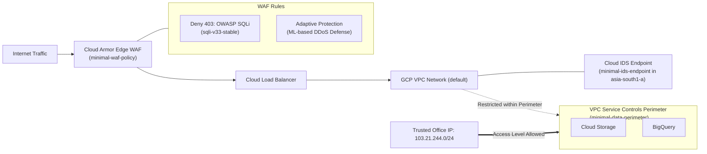

# SecOps Domain 4: Edge Security, Threat Inspection & VPC Service Controls

This directory implements Google Cloud edge and perimeter defense mechanisms: **Cloud Armor Web Application Firewall (WAF)** for OWASP Top 10 mitigation, **Cloud IDS** for deep packet inspection and intrusion detection, and **VPC Service Controls (VPC-SC)** perimeters to prevent unauthorized data exfiltration.

---

## Defense-in-Depth Edge Architecture



---

## Technical Specifications

Driven declaratively by [`edge-security.yaml`](./edge-security.yaml):

### 1. Cloud Armor WAF Policy (`minimal-waf-policy`)
* **Default Rule Action**: `ALLOW`
* **Adaptive Protection**: `true` (enables Layer 7 machine-learning DDoS and anomaly detection).
* **OWASP SQL Injection Rule**:
  * Priority: `1000`
  * Action: `DENY(403)`
  * Rule Set: Preconfigured WAF expression `evaluatePreconfiguredExpr('sqli-v33-stable')`.

### 2. Cloud IDS Inspection Endpoint (`minimal-ids-endpoint`)
* **Location**: `asia-south1-a` (Mumbai zone).
* **VPC Network**: `default`.
* **Severity Level**: `MEDIUM` and above.
* **Role**: Leverages Palo Alto Networks threat intelligence engine built natively into Google Cloud to inspect inter-VM and egress traffic for malware, spyware, and lateral movement.

### 3. VPC Service Controls (`minimal-data-perimeter`)
* **Access Policy**: Configured under numeric Organization Access Policy ID.
* **Restricted Services**:
  * `storage.googleapis.com` (Cloud Storage)
  * `bigquery.googleapis.com` (BigQuery)
* **Protected Resources**: `projects/986244541727` (`yuvaraj-internal-project`).
* **Ingress Access Level**: `trusted-office-ip` (`103.21.244.0/24`), blocking any access from outside authorized office CIDRs.

---

## File Manifest

* [`main.tf`](./main.tf) — Invokes `git::https://github.com/yuva-cloud-devops/gcp-terraform-custom-modules.git//secops-infrastructure/edge-security-infra?ref=main`.
* [`edge-security.yaml`](./edge-security.yaml) — Declarative YAML specification for Cloud Armor WAF, Cloud IDS endpoints, and VPC-SC perimeter.

---

## Execution Guide

```powershell
cd d:\GCP-DevOps-WorkSpace\gcp-terraform-best-practices\3-secops-infrastructure-terraform-testing\edge-security

# Initialize Terraform
terraform init

# Validate configuration
terraform validate

# Inspect changes
terraform plan

# Deploy edge security controls
terraform apply
```

---

## Verification Commands

```powershell
# List Cloud Armor security policies
gcloud compute security-policies list --project=yuvaraj-internal-project

# Describe WAF policy rules
gcloud compute security-policies describe minimal-waf-policy --project=yuvaraj-internal-project

# Check Cloud IDS endpoints
gcloud ids endpoints list --zone=asia-south1-a --project=yuvaraj-internal-project
```
