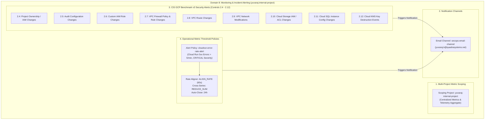

# Domain 8: Monitoring & Incident Alerting Infrastructure

This module provisions centralized **Cloud Monitoring, Multi-Channel Alerting, and Automated Compliance Alert Policies** for Google Cloud Platform using Terraform. It establishes multi-project metric scoping, notification channels, automated incident alert policies mapped to **CIS GCP Benchmark v3 controls 2.4 through 2.12**, and custom operational metric threshold alerts via declarative YAML configuration.

Driven by the custom module [`monitoring-alerting-infra`](https://github.com/yuva-cloud-devops/gcp-terraform-custom-modules) in [`yuva-cloud-devops/gcp-terraform-custom-modules`](https://github.com/yuva-cloud-devops/gcp-terraform-custom-modules), it targets `yuvaraj-internal-project`.

---

## Observability & Alerting Architecture



---

## Technical Specifications & Capabilities

| Capability | Component Name | Technical Specification | Operational & Compliance Value |
| :--- | :--- | :--- | :--- |
| **Metric Scoping** | `scoping_project` | Centralized Cloud Monitoring workspace scoping `yuvaraj-internal-project`. | Unified cross-project observability and metric correlation |
| **Notification Channel** | `secops-email-channel` | Cloud Monitoring Notification Channel (`type: email`, target: `yuvaraj.k@quadrasystems.net`). | Immediate human dispatch upon critical security or operational incidents |
| **CIS Benchmark Alerts** | `cis_security_alerts` | Automated generation of 9 log-based metric alert policies (CIS controls 2.4–2.12) with 7-day auto-close. | Continuous security compliance and unauthorized configuration change detection |
| **Operational Thresholds** | `cloudrun-error-rate-alert` | Metric filter `run.googleapis.com/request_count` with `response_code_class = "5xx"`, threshold > 5 / min, duration 60s. | Real-time production microservice degradation detection |

---

## CIS GCP Benchmark v3 Controls Mapping

| CIS Control | Alert Policy Name | Monitored Security Event |
| :---: | :--- | :--- |
| **2.4** | `cis-alert-audit-logging-iam-changes` | Modifications to project-level IAM roles, permissions, or service accounts |
| **2.5** | `cis-alert-audit-logging-audit-config-changes` | Changes to organization, folder, or project Cloud Audit configurations |
| **2.6** | `cis-alert-audit-logging-custom-role-changes` | Creation, update, or deletion of custom IAM roles |
| **2.7** | `cis-alert-audit-logging-firewall-rule-changes` | Creation, modification, or deletion of VPC firewall rules or policies |
| **2.8** | `cis-alert-audit-logging-route-changes` | Creation, modification, or deletion of VPC network routes |
| **2.9** | `cis-alert-audit-logging-network-changes` | Creation, modification, or deletion of VPC networks or subnets |
| **2.10** | `cis-alert-audit-logging-storage-iam-changes` | Changes to Cloud Storage bucket IAM policies or ACLs |
| **2.11** | `cis-alert-audit-logging-cloudsql-changes` | Modifications to Cloud SQL database instance configuration flags |
| **2.12** | `cis-alert-audit-logging-kms-key-destruction` | Scheduled or executed destruction of Cloud KMS CryptoKeys |

---

## Directory Structure

```text
3-secops-infrastructure-terraform-testing/monitoring-alerting/
├── README.md                          # Monitoring & Alerting Guide (This File)
├── main.tf                            # Terraform Provider & Custom Module Invocation
├── monitoring-alerting.yaml           # Declarative Specification (Scopes, Channels, CIS & Custom Alerts)
├── .terraform.lock.hcl                # Provider Dependency Lock File
└── terraform.tfstate                  # Local Terraform State
```

---

## YAML Configuration Breakdown

The deployment is managed through [monitoring-alerting.yaml](file:///d:/GCP-DevOps-WorkSpace/gcp-terraform-best-practices/3-secops-infrastructure-terraform-testing/monitoring-alerting/monitoring-alerting.yaml):

```yaml
project_id: "yuvaraj-internal-project"

common_labels:
  environment: "testing"
  managed_by: "terraform"
  domain: "secops-monitoring"

# 1. Multi-Project Metric Scoping
metric_scopes:
  scoping_project: "yuvaraj-internal-project"
  monitored_projects: []

# 2. Notification Channels
notification_channels:
  - name: "secops-email-channel"
    type: "email"
    display_name: "SecOps Security Team Email"
    labels:
      email_address: "yuvaraj.k@quadrasystems.net"

# 3. CIS GCP Benchmark v3 Alerts (Controls 2.4 - 2.12)
cis_security_alerts:
  enable: true
  auto_close: "604800s" # 7 days
  notification_channels:
    - "secops-email-channel"

# 4. Custom Operational Metric Threshold Alert
alert_policies:
  - name: "cloudrun-error-rate-alert"
    display_name: "Cloud Run Elevated 5xx Errors"
    severity: "CRITICAL"
    auto_close: "86400s"
    notification_channels:
      - "secops-email-channel"
    conditions:
      - type: "threshold"
        display_name: "Cloud Run 5xx Errors > 5/min"
        filter: 'resource.type = "cloud_run_revision" AND metric.type = "run.googleapis.com/request_count" AND metric.label.response_code_class = "5xx"'
        comparison: "COMPARISON_GT"
        threshold_value: 5
        duration: "60s"
        alignment_period: "60s"
        per_series_aligner: "ALIGN_RATE"
        cross_series_reducer: "REDUCE_SUM"
```

---

## Deployment & Verification Guide

### 1. Initialize & Apply
```bash
cd d:/GCP-DevOps-WorkSpace/gcp-terraform-best-practices/3-secops-infrastructure-terraform-testing/monitoring-alerting
terraform init
terraform plan
terraform apply -auto-approve
```

### 2. Verify with gcloud
```bash
# List configured notification channels
gcloud monitoring channels list

# List alert policies and verify active state
gcloud alpha monitoring policies list --format="table(displayName,enabled,severity,conditions[0].displayName)"

# Verify specific CIS benchmark alert policy
gcloud alpha monitoring policies list --filter="displayName~'CIS'"
```

---

## Navigation

- [Master SecOps Testing Suite (Module 3)](file:///d:/GCP-DevOps-WorkSpace/gcp-terraform-best-practices/3-secops-infrastructure-terraform-testing/README.md)
- [Domain 7: Zero-Trust Security](file:///d:/GCP-DevOps-WorkSpace/gcp-terraform-best-practices/3-secops-infrastructure-terraform-testing/zero-trust-security/README.md)
- [Domain 9: Dashboards & Synthetic Uptime](file:///d:/GCP-DevOps-WorkSpace/gcp-terraform-best-practices/3-secops-infrastructure-terraform-testing/dashboards-uptime/README.md)
