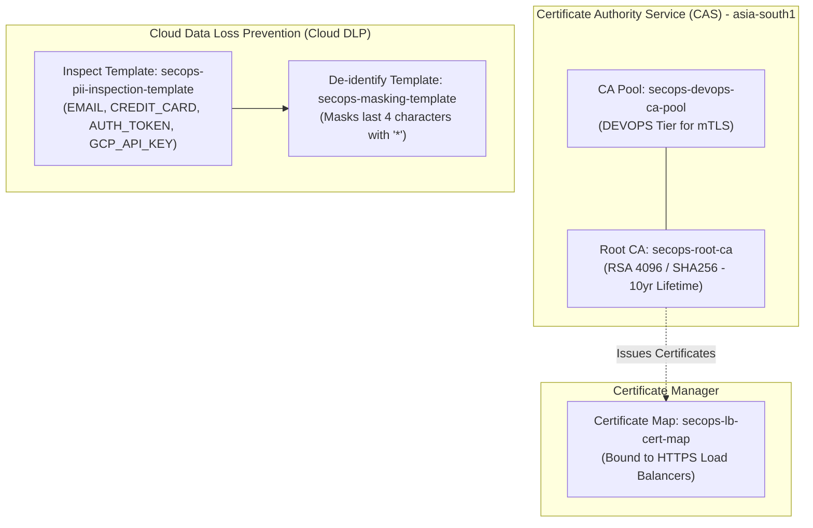

# SecOps Domain 5: PKI & Sensitive Data Security

This directory implements enterprise Public Key Infrastructure (PKI) and sensitive data governance on Google Cloud using **Certificate Authority Service (CAS)**, **Certificate Manager**, and **Cloud Data Loss Prevention (Cloud DLP)**.

---

## PKI & Data Security Architecture



---

## Technical Specifications

Driven declaratively by [`pki-data-security.yaml`](./pki-data-security.yaml):

### 1. Private Certificate Authority Service (CAS)
* **CA Pool (`secops-devops-ca-pool`)**:
  * Tier: `DEVOPS` (cost-effective, high-throughput certificate issuance for internal microservices, Kubernetes pods, and mTLS).
  * Location: `asia-south1`.
  * Publishing Options: Publishes CA certificate; disables public CRL for internal scoping.
* **Certificate Authority (`secops-root-ca`)**:
  * Type: `SELF_SIGNED` Root CA.
  * Lifetime: 10 years (`315360000s`).
  * Key Specification: `RSA_PKCS1_4096_SHA256`.
  * Subject: `CN=SecOps Internal Root CA`, `O=Yuvaraj Cloud SecOps`, `C=IN`.

### 2. Certificate Manager Maps
* **Certificate Map (`secops-lb-cert-map`)**:
  * Purpose: Centralized management and dynamic mapping of SSL/TLS certificates attached to external and internal Google Cloud Load Balancers without requiring load balancer redeployments.

### 3. Cloud Data Loss Prevention (DLP) Templates
* **Inspection Template (`secops-pii-inspection-template`)**:
  * Scans for high-risk data types:
    * `EMAIL_ADDRESS`
    * `CREDIT_CARD_NUMBER`
    * `AUTH_TOKEN`
    * `GCP_API_KEY`
  * Minimum Likelihood: `LIKELY`.
* **De-identification Template (`secops-masking-template`)**:
  * Transformation Type: Character masking with `*`.
  * Masks the last 4 characters with `reverse_order = true`.

---

## File Manifest

* [`main.tf`](./main.tf) — Invokes `git::https://github.com/yuva-cloud-devops/gcp-terraform-custom-modules.git//secops-infrastructure/pki-data-security-infra?ref=main`.
* [`pki-data-security.yaml`](./pki-data-security.yaml) — Declarative YAML specification for CA pool, root CA, certificate maps, and DLP inspection/de-identification templates.

---

## Execution Guide

```powershell
cd d:\GCP-DevOps-WorkSpace\gcp-terraform-best-practices\3-secops-infrastructure-terraform-testing\pki-data-security

# Initialize Terraform modules
terraform init

# Validate configuration
terraform validate

# Inspect changes
terraform plan

# Apply PKI and data governance layer
terraform apply
```

---

## Verification Commands

```powershell
# List Certificate Authority pools
gcloud privateca pools list --location=asia-south1 --project=yuvaraj-internal-project

# Check Root CA status
gcloud privateca roots list --pool=secops-devops-ca-pool --location=asia-south1 --project=yuvaraj-internal-project

# List Certificate Manager maps
gcloud certificate-manager maps list --project=yuvaraj-internal-project

# List Cloud DLP inspect templates
gcloud dlp inspect-templates list --project=yuvaraj-internal-project
```
