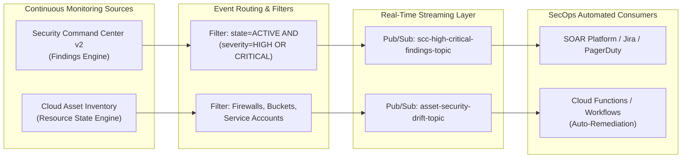

# SecOps Domain 6: Threat Posture & Asset Governance

This directory implements centralized security posture monitoring and configuration drift detection using **Security Command Center (SCC v2)** real-time notification feeds and **Cloud Asset Inventory (CAI)** real-time drift feeds.

---

## Threat Posture Architecture



---

## Technical Specifications

Driven declaratively by [`threat-posture.yaml`](./threat-posture.yaml):

### 1. Security Command Center (SCC v2) Finding Notifications
* **Notification Config**: `secops-high-critical-alerts`
* **Target Pub/Sub Topic**: `scc-high-critical-findings-topic`
* **Filter Expression**:
  ```sql
  state="ACTIVE" AND (severity="HIGH" OR severity="CRITICAL")
  ```
* **Capabilities**: Immediately alerts SecOps incident responders when high or critical findings (e.g., public storage bucket, exposed service account key, anomalous API calls) are discovered by SCC.

### 2. Cloud Asset Inventory (CAI) Real-Time Drift Feeds
* **Feed Name**: `track-security-assets`
* **Target Pub/Sub Topic**: `asset-security-drift-topic`
* **Content Type**: `RESOURCE`
* **Tracked Asset Types**:
  * `compute.googleapis.com/Firewall` — Immediate alerts when a firewall rule is modified or inserted.
  * `storage.googleapis.com/Bucket` — Immediate alerts when bucket ACLs or public access prevention change.
  * `iam.googleapis.com/ServiceAccount` — Immediate alerts on new service account creation or key generation.

---

## File Manifest

* [`main.tf`](./main.tf) — Invokes `git::https://github.com/yuva-cloud-devops/gcp-terraform-custom-modules.git//secops-infrastructure/threat-posture-infra?ref=main`.
* [`threat-posture.yaml`](./threat-posture.yaml) — Declarative YAML specification for SCC notification filters, CAI asset types, and Pub/Sub topics.

---

## Execution Guide

```powershell
cd d:\GCP-DevOps-WorkSpace\gcp-terraform-best-practices\3-secops-infrastructure-terraform-testing\threat-posture

# Initialize Terraform modules
terraform init

# Validate configuration
terraform validate

# Inspect changes
terraform plan

# Apply threat posture infrastructure
terraform apply
```

---

## Verification Commands

```powershell
# List SCC notification configs
gcloud scc notifications list --project=yuvaraj-internal-project

# List Cloud Asset Inventory feeds
gcloud asset feeds list --project=yuvaraj-internal-project

# List Pub/Sub topics
gcloud pubsub topics list --project=yuvaraj-internal-project
```
