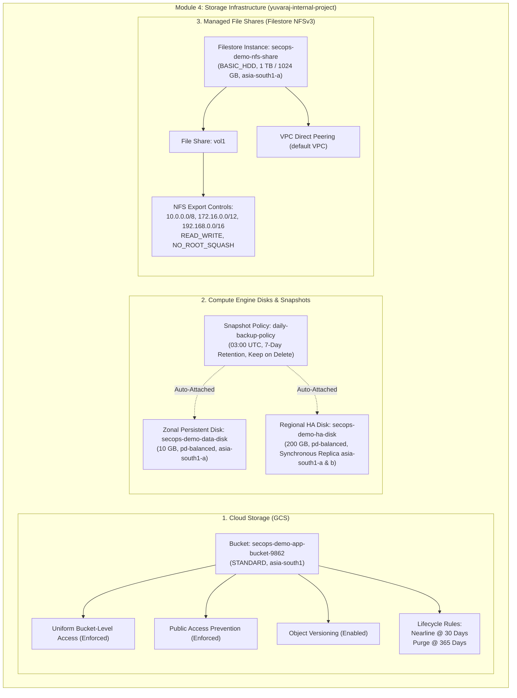

# Module 4: Cloud Storage Infrastructure Terraform Testing

This module implements and validates enterprise-grade **Cloud Storage Infrastructure** on Google Cloud Platform using Terraform. It provisions scalable object storage, high-availability block storage with automated snapshot governance, and enterprise managed file storage (NFS) via declarative YAML configuration.

Driven by the custom module registry [`yuva-cloud-devops/gcp-terraform-custom-modules`](https://github.com/yuva-cloud-devops/gcp-terraform-custom-modules), it connects to `yuvaraj-internal-project` in region `asia-south1`.

---

## Storage Architecture Overview



---

## Component & Technical Specifications

| Storage Tier | Component Name | Technical Specification | SLA & High Availability |
| :--- | :--- | :--- | :--- |
| **Object Storage** | `secops-demo-app-bucket-9862` | GCS Standard class, UBLA enforced, Public Access Prevention enforced, Versioning enabled, Force destroy enabled, 30-day Nearline tiering, 365-day deletion lifecycle. | 99.99% availability, 11 9's durability |
| **Block Storage (Zonal)** | `secops-demo-data-disk` | 10 GB `pd-balanced`, Zone `asia-south1-a`, attached to automated daily snapshot policy (`daily-backup-policy`). | Zonal resilience, automatic point-in-time recovery |
| **Block Storage (Regional HA)** | `secops-demo-ha-disk` | 200 GB `pd-balanced`, Synchronous cross-zone replication between `asia-south1-a` and `asia-south1-b`, attached to daily snapshot policy. | Cross-zone synchronous RPO=0 failover |
| **Snapshot Governance** | `daily-backup-policy` | Daily cycle at 03:00 UTC, 7-day rolling retention, `KEEP_AUTO_SNAPSHOTS` on parent disk deletion, stored in `asia-south1`. | Automated data protection & disaster recovery |
| **Shared File Storage** | `secops-demo-nfs-share` | Filestore `BASIC_HDD`, 1 TB capacity, NFSv3 protocol, volume `vol1`, multi-CIDR export controls (`NO_ROOT_SQUASH`), direct VPC peering. | Enterprise shared storage for compute clusters |

---

## Directory Structure

```text
4-storage-infrastructure-terraform-testing/
├── README.md                          # Storage Infrastructure Architecture & Guide (This File)
├── main.tf                            # Terraform Provider & Custom Module Invocation
├── storage-infrastructure.yaml        # Declarative Specification (GCS, Disks, Snapshots, Filestore)
├── .terraform.lock.hcl                # Provider Dependency Lock File
└── terraform.tfstate                  # Local Terraform State
```

---

## YAML Configuration Breakdown

The deployment is managed through [storage-infrastructure.yaml](file:///d:/GCP-DevOps-WorkSpace/gcp-terraform-best-practices/4-storage-infrastructure-terraform-testing/storage-infrastructure.yaml):

```yaml
storage_infrastructure:
  project_id: "yuvaraj-internal-project"
  region: "asia-south1"

  # 1. Cloud Storage
  gcs:
    buckets:
      secops-demo-app-bucket-9862:
        location: "asia-south1"
        storage_class: "STANDARD"
        uniform_bucket_level_access: true
        public_access_prevention: "enforced"
        versioning: true
        force_destroy: true
        lifecycle_rules:
          - action: { type: "SetStorageClass", storage_class: "NEARLINE" }
            condition: { age: 30 }
          - action: { type: "Delete" }
            condition: { age: 365 }

  # 2. Compute Disks & Snapshots
  compute_disks:
    snapshot_policies:
      daily-backup-policy:
        region: "asia-south1"
        schedule:
          daily: { days_in_cycle: 1, start_time: "03:00" }
        retention_policy:
          max_retention_days: 7
          on_source_disk_delete: "KEEP_AUTO_SNAPSHOTS"
    zonal_disks:
      secops-demo-data-disk:
        zone: "asia-south1-a"
        size_gb: 10
        type: "pd-balanced"
        snapshot_policy: "daily-backup-policy"
    regional_disks:
      secops-demo-ha-disk:
        region: "asia-south1"
        replica_zones: ["asia-south1-a", "asia-south1-b"]
        size_gb: 200
        type: "pd-balanced"
        snapshot_policy: "daily-backup-policy"

  # 3. Filestore NFS
  filestore:
    instances:
      secops-demo-nfs-share:
        zone: "asia-south1-a"
        tier: "BASIC_HDD"
        file_shares:
          name: "vol1"
          capacity_gb: 1024
          nfs_export_options:
            - ip_ranges: ["10.0.0.0/8", "172.16.0.0/12", "192.168.0.0/16"]
              access_mode: "READ_WRITE"
              squash_mode: "NO_ROOT_SQUASH"
        network:
          name: "default"
          connect_mode: "DIRECT_PEERING"
```

---

## Deployment & Verification Guide

### 1. Initialize & Apply
```bash
cd d:/GCP-DevOps-WorkSpace/gcp-terraform-best-practices/4-storage-infrastructure-terraform-testing
terraform init
terraform plan
terraform apply -auto-approve
```

### 2. Verify with gcloud
```bash
# Verify GCS Bucket & Security Controls
gcloud storage buckets describe gs://secops-demo-app-bucket-9862 --format="yaml(uniformBucketLevelAccess,publicAccessPrevention,versioning)"

# Verify Persistent Disks & Attached Policies
gcloud compute disks describe secops-demo-data-disk --zone=asia-south1-a --format="table(name,sizeGb,type,resourcePolicies)"
gcloud compute disks describe secops-demo-ha-disk --region=asia-south1 --format="table(name,sizeGb,replicaZones,resourcePolicies)"

# Verify Snapshot Policy
gcloud compute resource-policies describe daily-backup-policy --region=asia-south1

# Verify Filestore Instance
gcloud filestore instances describe secops-demo-nfs-share --zone=asia-south1-a --format="table(name,tier,fileShares[0].capacityGb,networks[0].ipAddresses)"
```

---

## Navigation

- [Root Repository Architecture](file:///d:/GCP-DevOps-WorkSpace/gcp-terraform-best-practices/README.md)
- [Module 3: SecOps Infrastructure Testing](file:///d:/GCP-DevOps-WorkSpace/gcp-terraform-best-practices/3-secops-infrastructure-terraform-testing/README.md)
- [Module 5: Database Infrastructure Testing](file:///d:/GCP-DevOps-WorkSpace/gcp-terraform-best-practices/5-database-infrastructure-terraform-testing/README.md)
