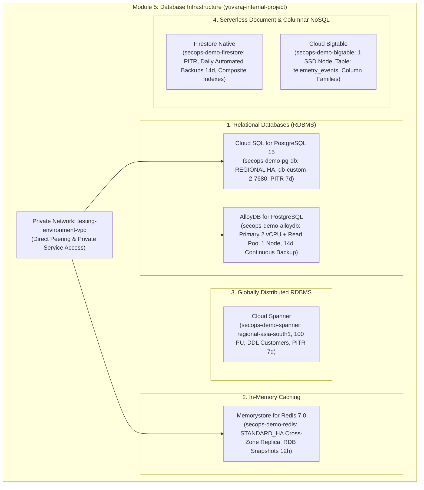

# Module 5: Database Infrastructure Terraform Testing

This module provisions and tests enterprise **Database Infrastructure** across all major managed database engines on Google Cloud Platform using Terraform. It establishes relational, distributed SQL, in-memory caching, serverless document NoSQL, and high-throughput columnar databases via declarative YAML configuration.

Driven by the custom module registry [`yuva-cloud-devops/gcp-terraform-custom-modules`](https://github.com/yuva-cloud-devops/gcp-terraform-custom-modules), it deploys into `yuvaraj-internal-project` with private VPC connectivity on `testing-environment-vpc`.

---

## Database Architecture Overview



---

## Managed Database Engines & Specifications

| Database Engine | GCP Service | Deployment Profile | High Availability & Protection |
| :--- | :--- | :--- | :--- |
| **PostgreSQL 15** | Cloud SQL | `secops-demo-pg-db` (`db-custom-2-7680`, 20GB SSD auto-resize to 100GB, private VPC + SSL `ENCRYPTED_ONLY`) | `REGIONAL` HA automatic failover, PITR, 7-day automated backups & WAL logs |
| **AlloyDB PostgreSQL** | AlloyDB | `secops-demo-alloydb` (Cluster + Primary 2 vCPU + Read Pool 1 node 2 vCPU, `app_user` superuser) | Continuous backups (14-day retention), automated weekly backups (Sun & Wed 03:00) |
| **In-Memory Redis** | Memorystore | `secops-demo-redis` (1 GB, Redis 7.0, AUTH password enabled, transit encryption) | `STANDARD_HA` multi-zone automatic failover, RDB snapshot schedules (12 hours) |
| **NoSQL Document** | Firestore | `secops-demo-firestore` (Native mode in `asia-south1`, composite index on `users.role` ASC & `users.score` DESC) | Point-in-time recovery, automated daily backup schedule with 14-day retention, delete protection |
| **Distributed RDBMS** | Cloud Spanner | `secops-demo-spanner` (`regional-asia-south1`, 100 Processing Units, database `ecommerce-db`) | 99.99% regional SLA, 7-day version retention PITR, automated daily cron backups (`0 2 * * *`) |
| **Columnar NoSQL** | Cloud Bigtable | `secops-demo-bigtable` (`analytics-cluster-1`, 1 SSD node in `asia-south1-a`, table `telemetry_events`) | Low-latency sub-10ms analytics, column families: `metrics`, `device_info` |

---

## Directory Structure

```text
5-database-infrastructure-terraform-testing/
├── README.md                          # Database Infrastructure Architecture & Guide (This File)
├── main.tf                            # Terraform Provider & Custom Module Invocation
├── database-infrastructure.yaml       # Declarative Specification (Cloud SQL, AlloyDB, Redis, Firestore, Spanner, Bigtable)
├── .terraform.lock.hcl                # Provider Dependency Lock File
└── terraform.tfstate                  # Local Terraform State
```

---

## YAML Configuration Breakdown

The deployment is managed through [database-infrastructure.yaml](file:///d:/GCP-DevOps-WorkSpace/gcp-terraform-best-practices/5-database-infrastructure-terraform-testing/database-infrastructure.yaml):

```yaml
database_infrastructure:
  project_id: "yuvaraj-internal-project"
  region: "asia-south1"
  network: "projects/yuvaraj-internal-project/global/networks/testing-environment-vpc"

  # 1. Cloud SQL (PostgreSQL HA)
  cloud_sql:
    instances:
      secops-demo-pg-db:
        database_version: "POSTGRES_15"
        tier: "db-custom-2-7680"
        availability_type: "REGIONAL"
        disk_type: "PD_SSD"
        disk_size_gb: 20
        disk_autoresize: true
        ssl_mode: "ENCRYPTED_ONLY"
        enable_point_in_time_recovery: true
        backup_retention_days: 7
        databases:
          - name: "app_production"
            charset: "UTF8"
        users:
          - name: "app_user"
            password: "DemoUserPassword123!"

  # 2. AlloyDB for PostgreSQL
  alloydb:
    clusters:
      secops-demo-alloydb:
        continuous_backup_retention_days: 14
        weekly_backup_days: ["SUNDAY", "WEDNESDAY"]
        primary_instance: { instance_id: "alloydb-primary", cpu_count: 2 }
        read_pools:
          - { instance_id: "alloydb-read-pool-1", cpu_count: 2, node_count: 1 }

  # 3. Memorystore Redis
  memorystore_redis:
    instances:
      secops-demo-redis:
        tier: "STANDARD_HA"
        memory_size_gb: 1
        redis_version: "REDIS_7_0"
        auth_enabled: true
        rdb_snapshot_period: "TWELVE_HOURS"

  # 4. Firestore NoSQL
  firestore:
    databases:
      secops-demo-firestore:
        name: "secops-nosql-db"
        type: "FIRESTORE_NATIVE"
        location_id: "asia-south1"
        point_in_time_recovery_enablement: "POINT_IN_TIME_RECOVERY_ENABLED"
        backup_schedules: [{ retention_days: 14, recurrence: "daily" }]

  # 5. Cloud Spanner
  spanner:
    instances:
      secops-demo-spanner:
        config: "regional-asia-south1"
        processing_units: 100
        databases:
          - name: "ecommerce-db"
            version_retention_period: "7d"
            ddl: ["CREATE TABLE Customers (CustomerId STRING(36) NOT NULL, Email STRING(255), Name STRING(255)) PRIMARY KEY (CustomerId)"]

  # 6. Cloud Bigtable
  bigtable:
    instances:
      secops-demo-bigtable:
        clusters: [{ cluster_id: "analytics-cluster-1", zone: "asia-south1-a", num_nodes: 1, storage_type: "SSD" }]
        tables:
          - name: "telemetry_events"
            column_families: [{ family: "metrics" }, { family: "device_info" }]
```

---

## Deployment & Verification Guide

### 1. Initialize & Apply
```bash
cd d:/GCP-DevOps-WorkSpace/gcp-terraform-best-practices/5-database-infrastructure-terraform-testing
terraform init
terraform plan
terraform apply -auto-approve
```

### 2. Verify with gcloud
```bash
# Verify Cloud SQL PostgreSQL HA Status
gcloud sql instances describe secops-demo-pg-db --format="table(name,databaseVersion,settings.tier,settings.availabilityType,state)"

# Verify AlloyDB Cluster & Instances
gcloud alloydb clusters list --region=asia-south1
gcloud alloydb instances list --cluster=secops-demo-alloydb --region=asia-south1

# Verify Memorystore Redis HA
gcloud redis instances describe secops-demo-redis --region=asia-south1 --format="table(name,tier,memorySizeGb,redisVersion,state)"

# Verify Firestore Database
gcloud firestore databases describe --database=secops-nosql-db

# Verify Cloud Spanner Instance & Database
gcloud spanner instances describe secops-demo-spanner --format="table(name,config,processingUnits,state)"
gcloud spanner databases list --instance=secops-demo-spanner

# Verify Cloud Bigtable Cluster & Tables
gcloud bigtable instances describe secops-demo-bigtable
gcloud bigtable tables list --instances=secops-demo-bigtable
```

---

## Navigation

- [Root Repository Architecture](file:///d:/GCP-DevOps-WorkSpace/gcp-terraform-best-practices/README.md)
- [Module 4: Storage Infrastructure Testing](file:///d:/GCP-DevOps-WorkSpace/gcp-terraform-best-practices/4-storage-infrastructure-terraform-testing/README.md)
- [Module 6: Compute & Availability Testing](file:///d:/GCP-DevOps-WorkSpace/gcp-terraform-best-practices/6-compute-availability-infrastructure-terraform-testing/README.md)
