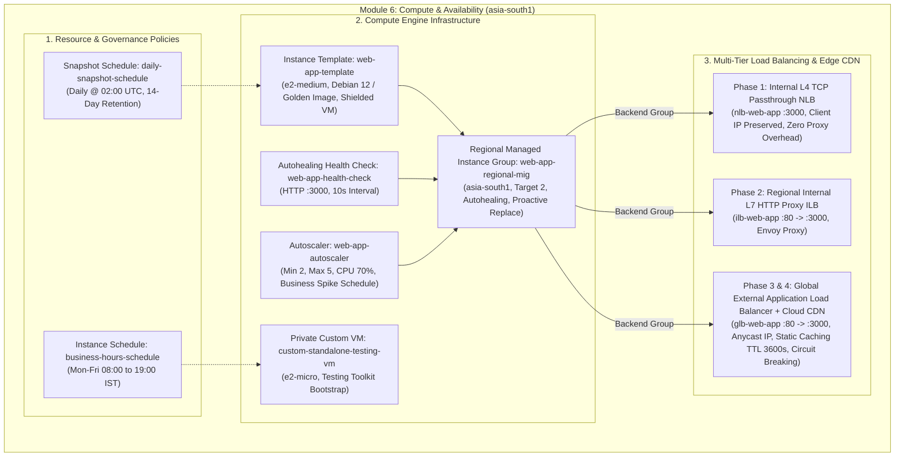

# Module 6: Compute Infrastructure & High Availability Testing

This module implements and validates enterprise **Compute Infrastructure** and **High-Availability Load Balancing** on Google Cloud Platform using Terraform. It provisions immutable instance templates, regional auto-healing Managed Instance Groups (MIGs), automated scheduling and snapshot policies, and multi-tier load balancing architectures (L4 TCP Passthrough, L7 Internal HTTP Envoy, and Global External HTTP with Cloud CDN).

Driven by custom modules [`compute-infrastructure`](https://github.com/yuva-cloud-devops/gcp-terraform-custom-modules) and [`availability-infrastructure`](https://github.com/yuva-cloud-devops/gcp-terraform-custom-modules), it seamlessly binds compute instance groups to load balancer backends in `yuvaraj-internal-project` on `testing-environment-vpc`.

---

## Architecture Overview



---

## Component & Load Balancing Specifications

| Architecture Tier | Resource / Component | Configuration Details | HA & Traffic Management |
| :--- | :--- | :--- | :--- |
| **Compute Template** | `web-app-template` | Machine type `e2-medium`, Debian 12 boot disk 20GB `pd-balanced`, Shielded VM (Secure Boot, vTPM, Integrity Monitoring). | Golden image consumption, auto-attaches snapshot schedule |
| **Standalone VM** | `custom-standalone-testing-vm` | Machine type `e2-micro`, purely private (no public IP), boots with [`scripts/custom-vm-bootstrap.sh`](file:///d:/GCP-DevOps-WorkSpace/gcp-terraform-best-practices/6-compute-availability-infrastructure-terraform-testing/scripts/custom-vm-bootstrap.sh). | Pre-installed diagnostic toolkit: `curl`, `ab`, `tcpdump`, `iperf3`, `stress-ng`, `netcat` |
| **Regional MIG** | `web-app-regional-mig` | Regional across zones `asia-south1-a, b, c`, target size 2, named port `http:3000`, auto-healing with initial delay 300s. | Proactive rolling replace, max surge 3, zero max unavailable |
| **Autoscaling** | `web-app-autoscaler` | Minimum 2 replicas, maximum 5 replicas, target CPU 70%, business hours spike schedule (`0 9 * * 1-5` IST). | Dynamic capacity scaling + scheduled pre-provisioning |
| **L4 Internal NLB** | `nlb-web-app` (Phase 1) | Regional Internal TCP load balancer, frontend port 3000, private subnet IP, dedicated TCP probe. | Direct server return, original client IP preserved, optional failover |
| **L7 Internal ILB** | `ilb-web-app` (Phase 2) | Regional Internal HTTP Envoy proxy, port 80 translating to named port `http:3000`. | Private path-based routing & microservices proxy |
| **Global External ALB** | `glb-web-app` (Phase 3 & 4) | Global External Managed Application Load Balancer, dedicated Anycast IPv4 address, outlier detection circuit breaker. | Anycast global edge routing, DDoS absorption, Cloud CDN static caching (`CACHE_ALL_STATIC`, 3600s TTL) |

---

## Directory Structure

```text
6-compute-availability-infrastructure-terraform-testing/
├── README.md                          # Master Compute & Availability Guide (This File)
├── main.tf                            # Dual Module Invocation (compute + availability)
├── compute-infrastructure.yaml        # Compute Specifications (Templates, VMs, MIGs, Autoscaling)
├── availability-infrastructure.yaml   # Load Balancer Specifications (L4 NLB, L7 ILB, Global ALB & CDN)
├── scripts/
│   ├── custom-vm-bootstrap.sh         # Diagnostics & Load Testing Suite (iperf3, stress-ng, ab, tcpdump)
│   └── bastion-bootstrap.sh          # Nginx Test Web Service Bootstrap
├── .terraform.lock.hcl                # Provider Dependency Lock File
└── terraform.tfstate                  # Local Terraform State
```

---

## Multi-Phase Load Balancer Testing Workflow

The configuration in [availability-infrastructure.yaml](file:///d:/GCP-DevOps-WorkSpace/gcp-terraform-best-practices/6-compute-availability-infrastructure-terraform-testing/availability-infrastructure.yaml) is structured into 4 progression phases:

1. **Phase 1: Internal L4 TCP Passthrough NLB**
   - Active by default. Provisions ultra-low-latency, zero-proxy internal load balancer forwarding traffic directly on port 3000.
2. **Phase 2: Regional Internal L7 HTTP Proxy Load Balancer**
   - Private Envoy proxy translating internal port 80 to MIG named port 3000 with HTTP health checks.
3. **Phase 3: Global External L7 Application Load Balancer**
   - Global Anycast IP exposing the MIG to internet traffic with HTTP/2 and outlier detection.
4. **Phase 4: Cloud CDN Edge Caching**
   - Toggle `enable_cdn: true` to cache static content at Google edge points-of-presence (PoPs).

---

## Deployment & Verification Guide

### 1. Initialize & Apply
```bash
cd d:/GCP-DevOps-WorkSpace/gcp-terraform-best-practices/6-compute-availability-infrastructure-terraform-testing
terraform init
terraform plan
terraform apply -auto-approve
```

### 2. Verify Compute Resources
```bash
# Check Standalone Test VM
gcloud compute instances list --filter="name=custom-standalone-testing-vm"

# Check Regional MIG & Health Status
gcloud compute instance-groups managed list-instances web-app-regional-mig --region=asia-south1

# Check Autoscaler Status
gcloud compute instance-groups managed describe web-app-regional-mig --region=asia-south1 --format="yaml(autoscaler)"
```

### 3. Verify Load Balancer Forwarding Rules
```bash
# Verify Internal L4 NLB Forwarding Rule & Backend Service
gcloud compute forwarding-rules list --filter="name~nlb-web-app"
gcloud compute backend-services get-health nlb-web-app-backend --region=asia-south1

# Verify Global External ALB (when enabled)
gcloud compute forwarding-rules list --global
```

---

## Navigation

- [Root Repository Architecture](file:///d:/GCP-DevOps-WorkSpace/gcp-terraform-best-practices/README.md)
- [Module 5: Database Infrastructure Testing](file:///d:/GCP-DevOps-WorkSpace/gcp-terraform-best-practices/5-database-infrastructure-terraform-testing/README.md)
- [Module 7: Containers Infrastructure Testing](file:///d:/GCP-DevOps-WorkSpace/gcp-terraform-best-practices/7-containers-infrastructure-terraform-testing/README.md)
