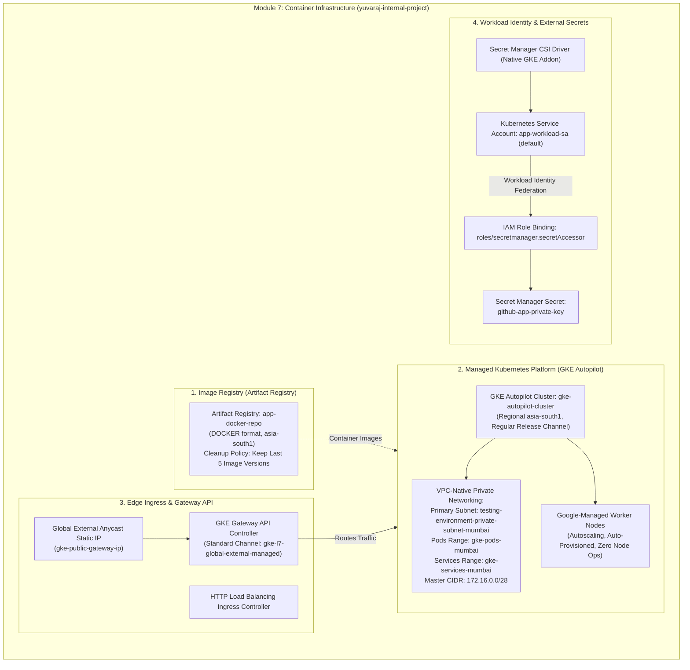

# Module 7: Container Infrastructure (GKE Autopilot) Terraform Testing

This module provisions and validates production-ready **Container Platform Infrastructure** on Google Cloud Platform using Terraform. It deploys Google Kubernetes Engine (GKE) in **Autopilot Mode**, automated Google Artifact Registry repositories, the next-generation **Kubernetes Gateway API Controller**, and seamless **Workload Identity** integration with Google Secret Manager.

Driven by the custom module registry [`yuva-cloud-devops/gcp-terraform-custom-modules`](https://github.com/yuva-cloud-devops/gcp-terraform-custom-modules), it provisions resources into `yuvaraj-internal-project` inside the private VPC network `testing-environment-vpc`.

---

## Container Platform Architecture



---

## Technical Specifications & Platform Features

| Capability | Component Name | Technical Specification | Operational Benefits |
| :--- | :--- | :--- | :--- |
| **Container Registry** | `app-docker-repo` | Artifact Registry (DOCKER format, `asia-south1`), automated cleanup policy retaining most recent 5 versions. | Automated image lifecycle, zero storage bloat, native IAM |
| **Kubernetes Engine** | `gke-autopilot-cluster` | GKE Autopilot mode, regional in `asia-south1`, private nodes (`enable_private_nodes: true`), regular release channel. | 100% Google-managed worker nodes, zero node maintenance, per-pod billing |
| **VPC-Native Networking** | Subnets & Ranges | Primary: `testing-environment-private-subnet-mumbai`, Secondary: `gke-pods-mumbai`, `gke-services-mumbai`, Master: `172.16.0.0/28`. | Native VPC routing, Pod IP routability, Private Google Access |
| **Gateway API Controller** | Addon: `CHANNEL_STANDARD` | Native Kubernetes Gateway API Controller enabled (`gateway_api_channel = "CHANNEL_STANDARD"`). | Expressive multi-tenant routing (`Gateway`, `HTTPRoute`), replaces legacy Ingress |
| **Public Gateway IP** | `gke-public-gateway-ip` | Global External Anycast static IPv4 reservation. | Dedicated stable public entrypoint for `gke-l7-global-external-managed` |
| **Secret Manager CSI** | Addon: `secret_manager: true` | Google Cloud Secret Manager CSI Driver natively injected into Autopilot cluster. | Mounts secrets as files into Pods directly from Secret Manager without K8s secrets |
| **Workload Identity** | `app-workload-sa` Binding | Direct IAM binding granting `app-workload-sa` in `default` namespace `roles/secretmanager.secretAccessor` on secret `github-app-private-key`. | Zero static service account keys, temporary short-lived OAuth tokens |

---

## Directory Structure

```text
7-containers-infrastructure-terraform-testing/
├── README.md                          # Container Platform Architecture & Guide (This File)
├── main.tf                            # Terraform Provider & Custom Module Invocation
├── container-infrastructure.yaml      # Declarative Specification (Artifact Registry, GKE, Gateway IP, Secrets)
├── .terraform.lock.hcl                # Provider Dependency Lock File
└── terraform.tfstate                  # Local Terraform State
```

---

## YAML Configuration Breakdown

The deployment is managed through [container-infrastructure.yaml](file:///d:/GCP-DevOps-WorkSpace/gcp-terraform-best-practices/7-containers-infrastructure-terraform-testing/container-infrastructure.yaml):

```yaml
container_infrastructure:
  project_id: "yuvaraj-internal-project"
  region: "asia-south1"
  network: "projects/yuvaraj-internal-project/global/networks/testing-environment-vpc"
  subnetwork: "projects/yuvaraj-internal-project/regions/asia-south1/subnetworks/testing-environment-private-subnet-mumbai"

  # 1. Artifact Registry
  artifact_registries:
    app-docker-repo:
      description: "Docker repository for microservice container images"
      format: "DOCKER"
      cleanup_policies:
        keep_recent_versions:
          action: "KEEP"
          most_recent_versions: { keep_count: 5 }

  # 2. GKE Autopilot Cluster
  clusters:
    gke-autopilot-cluster:
      mode: "AUTOPILOT"
      location: "asia-south1"
      pods_secondary_range_name: "gke-pods-mumbai"
      services_secondary_range_name: "gke-services-mumbai"
      master_ipv4_cidr_block: "172.16.0.0/28"
      enable_private_nodes: true
      enable_private_endpoint: false
      release_channel: "REGULAR"
      workload_identity: true
      addons:
        http_load_balancing: true
        gateway_api_channel: "CHANNEL_STANDARD"
        secret_manager: true

  # 3. Static Anycast IP for Gateway API
  ingress_gateways:
    ip_reservations:
      gke-public-gateway-ip:
        type: "GLOBAL_EXTERNAL"
        description: "Static Anycast IP for Public Gateway API"

  # 4. External Secrets Workload Identity Integration
  secrets_and_config:
    secret_manager_access:
      - secret_id: "projects/986244541727/secrets/github-app-private-key"
        namespace: "default"
        service_account: "app-workload-sa"
```

---

## Deployment & Verification Guide

### 1. Initialize & Apply
```bash
cd d:/GCP-DevOps-WorkSpace/gcp-terraform-best-practices/7-containers-infrastructure-terraform-testing
terraform init
terraform plan
terraform apply -auto-approve
```

### 2. Connect to GKE Cluster
```bash
# Fetch GKE cluster credentials
gcloud container clusters get-credentials gke-autopilot-cluster --region=asia-south1 --project=yuvaraj-internal-project

# Verify Nodes (Auto-Provisioned by Autopilot)
kubectl get nodes -o wide

# Verify Gateway API Custom Resource Definitions (CRDs)
kubectl get crd gateways.gateway.networking.k8s.io httproutes.gateway.networking.k8s.io
```

### 3. Verify Artifact Registry & Secret Access
```bash
# Verify Artifact Registry Repository
gcloud artifacts repositories describe app-docker-repo --location=asia-south1

# Verify Static Gateway IP Reservation
gcloud compute addresses describe gke-public-gateway-ip --global

# Verify Workload Identity Secret Access IAM
gcloud secrets get-iam-policy github-app-private-key --project=986244541727
```

---

## Navigation

- [Root Repository Architecture](file:///d:/GCP-DevOps-WorkSpace/gcp-terraform-best-practices/README.md)
- [Module 6: Compute & Availability Testing](file:///d:/GCP-DevOps-WorkSpace/gcp-terraform-best-practices/6-compute-availability-infrastructure-terraform-testing/README.md)
- [Module 8: Serverless Infrastructure Testing](file:///d:/GCP-DevOps-WorkSpace/gcp-terraform-best-practices/8-serverless-infrastructure-terraform-testing/README.md)
