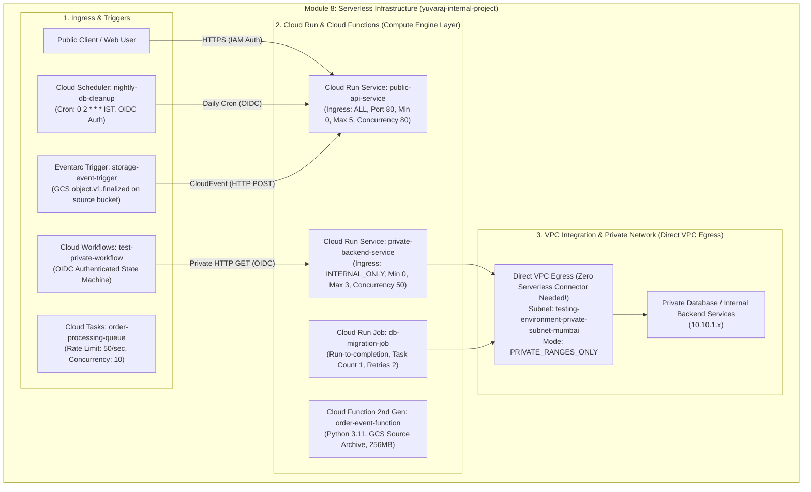

# Module 8: Serverless Infrastructure Terraform Testing

This module provisions and validates modern, production-grade **Serverless Infrastructure** on Google Cloud Platform using Terraform. It establishes containerized HTTP services on Cloud Run v2 with modern **Direct VPC Egress**, batch execution jobs, Cloud Functions 2nd Gen, event orchestration with Eventarc and Cloud Workflows, and asynchronous task scheduling via Cloud Tasks and Cloud Scheduler.

Driven declaratively by clean YAML configurations, it leverages reusable, production-ready modules from the custom module registry [`yuva-cloud-devops/gcp-terraform-custom-modules`](https://github.com/yuva-cloud-devops/gcp-terraform-custom-modules) in `yuvaraj-internal-project`.

---

## Serverless Architecture Overview



---

## Technical Specifications & Services Breakdown

| Service Component | GCP Resource | Technical Specification | Security & Operational Controls |
| :--- | :--- | :--- | :--- |
| **Public API Service** | Cloud Run v2 Service (`public-api-service`) | Container image `nginx:v1.0` from Artifact Registry, port 80, concurrency 80, autoscaling 0 to 5 instances, 1 vCPU / 512Mi. | Ingress `ALL`, IAM authenticated (`allow_unauthenticated: false`), restricted to authorized invokers. |
| **Private Microservice** | Cloud Run v2 Service (`private-backend-service`) | Isolated backend microservice, port 80, concurrency 50, autoscaling 0 to 3 instances, 1 vCPU / 512Mi. | Ingress `INTERNAL_ONLY`, **Direct VPC Egress** attached to private subnet, restricted invoker (Cloud Workflows SA). |
| **Batch Migration Job** | Cloud Run v2 Job (`db-migration-job`) | Run-to-completion containerized batch task, task count 1, parallelism 1, max retries 2, timeout 300s, action `migrate`. | **Direct VPC Egress** into private subnet to securely execute database schema migrations. |
| **2nd Gen Function** | Cloud Functions (`order-event-function`) | Python 3.11 runtime, entry point `hello_serverless`, source code archive in GCS bucket, timeout 60s, 256MB RAM. | Cloud Run-backed 2nd gen architecture, IAM authenticated, auto-scales 0 to 3 instances. |
| **State Orchestration** | Cloud Workflows (`test-private-workflow`) | Serverless state machine executing sequential workflow steps to invoke internal Cloud Run backend. | Built-in Google OIDC token minting, automatic retries, zero idle cost. |
| **Event Routing** | Eventarc Trigger (`storage-event-trigger`) | Eventarc trigger monitoring GCS bucket `yuvaraj-internal-serverless-sources-mumbai` for `object.v1.finalized`. | CloudEvents format, automatically routes storage upload events to `public-api-service`. |
| **Async Tasks Queue** | Cloud Tasks (`order-processing-queue`) | Dedicated asynchronous task queue, max 50 dispatches/sec, max 10 concurrent, burst 100, max 5 attempts. | Rate-limiting, deduplication, backoff retries, decoupling producer/consumer. |
| **Job Scheduling** | Cloud Scheduler (`nightly-db-cleanup`) | Cron schedule `0 2 * * *` (2:00 AM IST), target `public-api-service`. | Native OIDC authentication header via dedicated service account. |

---

## Direct VPC Egress Architecture Advantage

Traditional Cloud Run private networking required a **Serverless VPC Access Connector** (which introduces idle e2-micro VM costs, throughput bottlenecks, and maintenance overhead).

This module implements **Direct VPC Egress** (2024+ Best Practice):
```yaml
direct_vpc_egress:
  enabled: true
  subnetwork: "projects/yuvaraj-internal-project/regions/asia-south1/subnetworks/testing-environment-private-subnet-mumbai"
  egress_mode: "PRIVATE_RANGES_ONLY"
```
- **Zero Idle Infrastructure:** No connector VMs to pay for or manage.
- **Microsecond Latency:** Direct network interface routing inside the private subnet.
- **High Throughput:** Scales automatically up to 100 Gbps line rate without scaling connectors.

---

## Directory Structure

```text
8-serverless-infrastructure-terraform-testing/
├── README.md                          # Serverless Platform Architecture & Guide (This File)
├── main.tf                            # Terraform Provider & Custom Module Invocation
├── serverless-infrastructure.yaml     # Declarative Specification (Cloud Run, Jobs, Functions, Workflows, Triggers)
├── .terraform.lock.hcl                # Provider Dependency Lock File
└── terraform.tfstate                  # Local Terraform State
```

---

## YAML Configuration Breakdown

The deployment is managed through [serverless-infrastructure.yaml](file:///d:/GCP-DevOps-WorkSpace/gcp-terraform-best-practices/8-serverless-infrastructure-terraform-testing/serverless-infrastructure.yaml):

```yaml
serverless_infrastructure:
  project_id: "yuvaraj-internal-project"
  region: "asia-south1"
  network: "projects/yuvaraj-internal-project/global/networks/testing-environment-vpc"
  subnetwork: "projects/yuvaraj-internal-project/regions/asia-south1/subnetworks/testing-environment-private-subnet-mumbai"

  # 1. Cloud Run Services (v2 API)
  cloud_run_services:
    public-api-service:
      name: "public-api-service"
      image: "asia-south1-docker.pkg.dev/yuvaraj-internal-project/app-docker-repo/nginx:v1.0"
      port: 80
      ingress: "INGRESS_TRAFFIC_ALL"
      allow_unauthenticated: false
      concurrency: 80
      scaling: { min_instances: 0, max_instances: 5 }

    private-backend-service:
      name: "private-backend-service"
      image: "asia-south1-docker.pkg.dev/yuvaraj-internal-project/app-docker-repo/nginx:v1.0"
      port: 80
      ingress: "INGRESS_TRAFFIC_INTERNAL_ONLY"
      direct_vpc_egress:
        enabled: true
        subnetwork: "projects/yuvaraj-internal-project/regions/asia-south1/subnetworks/testing-environment-private-subnet-mumbai"
        egress_mode: "PRIVATE_RANGES_ONLY"

  # 2. Cloud Workflows
  cloud_workflows:
    test-private-workflow:
      description: "Invokes private Cloud Run backend"
      source_contents: |
        main:
          steps:
            - call_private_service:
                call: http.get
                args:
                  url: "https://private-backend-service-s5jg5ocgoa-el.a.run.app"
                  auth:
                    type: OIDC

  # 3. Cloud Run Jobs
  cloud_run_jobs:
    db-migration-job:
      image: "asia-south1-docker.pkg.dev/yuvaraj-internal-project/app-docker-repo/nginx:v1.0"
      task_count: 1
      direct_vpc_egress:
        enabled: true
        subnetwork: "projects/yuvaraj-internal-project/regions/asia-south1/subnetworks/testing-environment-private-subnet-mumbai"

  # 4. Cloud Functions 2nd Gen
  cloud_functions:
    order-event-function:
      runtime: "python311"
      entry_point: "hello_serverless"
      source_archive_bucket: "yuvaraj-internal-serverless-sources-mumbai"
      source_archive_object: "functions/function-source.zip"

  # 5. Cloud Tasks & Scheduler
  cloud_tasks_queues:
    order-processing-queue:
      max_dispatches_per_second: 50
      max_concurrent_dispatches: 10

  cloud_scheduler_jobs:
    nightly-db-cleanup:
      schedule: "0 2 * * *"
      time_zone: "Asia/Kolkata"

  # 6. Eventarc Triggers
  eventarc_triggers:
    storage-event-trigger:
      location: "asia-south1"
      destination:
        cloud_run_service: "public-api-service"
      event_filters:
        - attribute: "type"
          value: "google.cloud.storage.object.v1.finalized"
```

---

## Deployment & Verification Guide

### 1. Initialize & Apply
```bash
cd d:/GCP-DevOps-WorkSpace/gcp-terraform-best-practices/8-serverless-infrastructure-terraform-testing
terraform init
terraform plan
terraform apply -auto-approve
```

### 2. Verify with gcloud
```bash
# Verify Cloud Run Services
gcloud run services list --region=asia-south1
gcloud run services describe public-api-service --region=asia-south1 --format="table(status.url,status.conditions[0].status)"
gcloud run services describe private-backend-service --region=asia-south1 --format="table(status.url,spec.template.vpcAccess)"

# Execute and check Cloud Run Job
gcloud run jobs execute db-migration-job --region=asia-south1
gcloud run jobs executions list --job=db-migration-job --region=asia-south1

# Execute Cloud Workflow
gcloud workflows run test-private-workflow --location=asia-south1

# Verify Cloud Functions
gcloud functions list --regions=asia-south1

# Verify Cloud Tasks Queue & Cloud Scheduler Job
gcloud tasks queues describe order-processing-queue --location=asia-south1
gcloud scheduler jobs describe nightly-db-cleanup --location=asia-south1

# Verify Eventarc Trigger
gcloud eventarc triggers list --location=asia-south1
```

---

## Navigation

- [Root Repository Architecture](file:///d:/GCP-DevOps-WorkSpace/gcp-terraform-best-practices/README.md)
- [Module 7: Containers Infrastructure Testing](file:///d:/GCP-DevOps-WorkSpace/gcp-terraform-best-practices/7-containers-infrastructure-terraform-testing/README.md)
- [Module 0: GCP Services by Terraform](file:///d:/GCP-DevOps-WorkSpace/gcp-terraform-best-practices/0-gcp-services-by-terraform/Readme.md)
