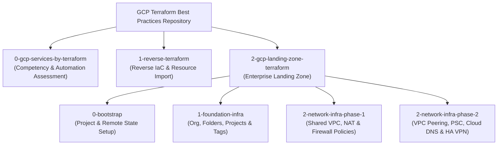

# Google Cloud Platform (GCP) Terraform Best Practices & Landing Zone

A production-grade, modular repository demonstrating **Google Cloud Platform (GCP) Infrastructure-as-Code (IaC)** using HashiCorp Terraform. This repository covers end-to-end cloud engineering competencies, from architectural assessment and reverse-engineering ClickOps resources to deploying a multi-tier enterprise Landing Zone.

---

## Repository Architecture & Structure



```text
gcp-terraform-best-practices/
├── README.md                                                        # Repository Master Index & Architecture (This File)
├── .gitignore                                                       # Global Terraform & State Ignores
│
├── 0-gcp-services-by-terraform/                                     # Module 0: Competency & Capability Matrix
│   └── Readme.md                                                    # 14-Domain Automation Matrix & Limits
│
├── 1-reverse-terraform/                                             # Module 1: Reverse Terraform (ClickOps-to-IaC)
│   ├── README.md                                                    # Declarative Import Guide & 4 Migration Methods
│   ├── import.tf                                                    # Terraform 1.5+ Declarative Import Block
│   ├── main.tf                                                      # Parameterized GCS Bucket Resource
│   ├── variables.tf & terraform.tfvars                              # Input Variables & Environment Config
│   ├── providers.tf                                                 # Google Provider (~> 6.0) Setup
│   └── outputs.tf                                                   # GCS URIs, Self Links & Console URLs
│
└── 2-gcp-landing-zone-terraform/                                     # Module 2: Enterprise GCP Landing Zone
    ├── README.md                                                    # Landing Zone Master Architecture & Execution
    │
    ├── 0-bootstrap/                                                 # Phase 0: Bootstrap & Governance
    │   ├── 1-IAM-Policy.md                                          # Required Org & Billing IAM Roles
    │   └── 2-bootstrap-project.md                                   # Bootstrap Project, GCS Bucket & Troubleshooting
    │
    ├── 1-foundation-infra/                                          # Phase 1: Foundation Infrastructure
    │   ├── README.md                                                # Foundation Phase Documentation
    │   ├── foundation.yaml                                          # YAML Specification (Folders, Projects, Tags)
    │   ├── main.tf                                                  # Module Invocation
    │   ├── provider.tf                                              # GCS Remote Backend (prefix = "foundation")
    │   ├── output.tf                                                # Exported Folder & Project Outputs
    │   └── output.txt                                               # Live State Outputs
    │
    ├── 2-network-infra-phase-1-vpc-shared-vpc-firewall-policy/      # Phase 2: Network Infrastructure Phase 1
    │   ├── README.md                                                # Network Infra Phase 1 Documentation
    │   ├── network-config.yaml                                      # VPC, Subnets, Routers, NAT & VPC Rules
    │   ├── shared_vpc.yaml                                          # Service Project Attachments & Subnet IAM
    │   ├── firewalls.yaml                                           # Folder Hierarchical Firewall Policy
    │   ├── main.tf                                                  # Multi-Module Composition
    │   ├── provider.tf                                              # GCS Remote Backend (prefix = "network-phase-1")
    │   ├── output.tf                                                # Network & Policy Outputs
    │   ├── output.txt                                               # Live Network State Outputs
    │   └── vm-test-output.txt                                       # End-to-End Validation Logs (IAP, NAT, PGA)
    │
    └── 2-network-infra-phase-2-vpc-peering-psc-dns-vpn/             # Phase 3 / Phase 2: Advanced Hybrid Network
        ├── README.md                                                # Network Infra Phase 2 Documentation
        ├── network.yaml                                             # Hub & Spoke Multi-VPC Architecture
        ├── peering.yaml                                             # Bi-Directional VPC Peering Specification
        ├── dns.yaml                                                 # Cloud DNS Private Zones & Service Discovery
        ├── psc.yaml                                                 # Private Service Connect (Google APIs)
        ├── vpn.yaml                                                 # HA Cloud VPN Gateway & Dynamic BGP Routing
        ├── main.tf                                                  # Multi-Module Orchestration
        ├── provider.tf                                              # GCP Provider Configuration
        ├── output.tf                                                # Network, DNS, PSC & VPN Outputs
        ├── output.txt                                               # Live Phase 2 State Outputs
        ├── testing.md                                               # Verification Playbook & Commands
        ├── test-out.txt                                             # Remote StrongSwan VM Setup Logs
        └── vpn-setup.md                                             # Automated StrongSwan/FRR Configuration Script
```

---

## Modules Overview

### [Module 0: Cloud Infrastructure Competency & Automation Assessment](./0-gcp-services-by-terraform/Readme.md)
A comprehensive master assessment matrix evaluating **14 foundational cloud infrastructure domains** in GCP:
- Identifies exact Terraform resources (`google_compute_network`, `google_storage_bucket`, `google_sql_database_instance`, etc.).
- Defines percentage of automatable infrastructure (ranging from 80% to 100%).
- Clearly documents the **Manual / External Boundaries** (what *cannot* be automated via Terraform, such as domain NS delegation, physical HSM ceremonies, OS golden image runtime patching, and Google Workspace user creation).

👉 **Read the Assessment**: [0-gcp-services-by-terraform/Readme.md](file:///d:/GCP-DevOps-WorkSpace/gcp-terraform-best-practices/0-gcp-services-by-terraform/Readme.md)

---

### [Module 1: Reverse Terraform (ClickOps-to-IaC Migration)](./1-reverse-terraform/README.md)
Demonstrates how to safely onboard existing unmanaged GCP resources into Terraform state and HCL code with **zero downtime and zero resource recreation**:
- Uses **Terraform 1.5+ declarative `import {}` blocks**.
- Covers 4 distinct reverse engineering workflows:
  1. Config-Driven Import into pre-structured parameterized HCL.
  2. Automatic Code Generation via `terraform plan -generate-config-out=generated.tf`.
  3. Classic imperative CLI import (`terraform import`).
  4. GCP-native resource export (`gcloud beta resource-config bulk-export`).
- Includes safety lifecycle controls (`lifecycle { prevent_destroy = true }`).

👉 **Read the Migration Guide**: [1-reverse-terraform/README.md](file:///d:/GCP-DevOps-WorkSpace/gcp-terraform-best-practices/1-reverse-terraform/README.md)

---

### [Module 2: Enterprise GCP Landing Zone](./2-gcp-landing-zone-terraform/README.md)
A modular, scalable, multi-project Landing Zone deployed in progressive phases:

#### 1. [Phase 0: Bootstrap & Remote State](./2-gcp-landing-zone-terraform/0-bootstrap/2-bootstrap-project.md)
- Creates dedicated bootstrap project `bootstrap-landing-zone-setup`.
- Provisions encrypted, versioned remote state bucket `gcp-terraform-landing-zone-tfstate-bucket` in `asia-south1`.
- Configures Application Default Credentials (ADC) quota routing and enables foundational APIs.
- Enforces organizational policy `compute.skipDefaultNetworkCreation`.
- Contains a comprehensive troubleshooting guide for common GCP landing zone deployment errors.

#### 2. [Phase 1: Foundation Infrastructure](./2-gcp-landing-zone-terraform/1-foundation-infra/README.md)
- Driven declaratively by [`foundation.yaml`](file:///d:/GCP-DevOps-WorkSpace/gcp-terraform-best-practices/2-gcp-landing-zone-terraform/1-foundation-infra/foundation.yaml).
- Deploys multi-tier folder structure: `core`, `workloads` (`development`, `production`), and `sandbox`.
- Provisions dynamic projects with collision-resistant IDs:
  - `core-network-host-crk2` (Network Host Project)
  - `dev-ecommerce-devlopment-dp2w` (Dev Workloads)
  - `prod-ecommerce-production-lvah` (Prod Workloads)
- Applies cryptographic resource tags (`environment`, `data_classification`) and creates baseline service accounts.

#### 3. [Phase 2: Network Infrastructure Phase 1 (Shared VPC)](./2-gcp-landing-zone-terraform/2-network-infra-phase-1-vpc-shared-vpc-firewall-policy/README.md)
- Provisions enterprise **Shared VPC** (`shared-vpc-vpc`) in the Host Project.
- Configures regional subnets in `asia-south1` (Dev: `10.20.1.0/24`) and `asia-southeast1` (Prod: `10.30.1.0/24`) with Private Google Access (PGA).
- Sets up **Cloud Routers** and **Cloud NAT** gateways for private, outbound-only internet connectivity.
- Attaches service projects and establishes granular **Subnet IAM delegations**.
- Enforces dual-layer security guardrails:
  - **Hierarchical Firewall Policy** on folder `core` (Rules: IAP SSH, Deny Public SSH/RDP, Allow Health Checks, Allow RFC1918).
  - **VPC Firewall Rules** for tagged workloads.
- **End-to-End Live Validation**: Verified via private VM (`test-vm-dev`) confirming IAP tunneling, private IP routing, Cloud NAT egress (`HTTP 200`), and Private Google Access (`HTTP 400 UploadServer`).

#### 4. [Phase 3 / Phase 2: Advanced Hybrid Network (Peering, PSC, DNS & HA VPN)](./2-gcp-landing-zone-terraform/2-network-infra-phase-2-vpc-peering-psc-dns-vpn/README.md)
- Deploys multi-region Hub-and-Spoke networks in `yuvaraj-internal-project`:
  - `vpc-hub` in Mumbai (`10.10.1.0/24`) and `vpc-sub` in Singapore (`10.20.1.0/24`).
- Configures bi-directional **VPC Network Peering** (`peering-hub-to-sub` / `peering-sub-to-hub`) with custom route export and import enabled.
- Establishes **Private Service Connect (PSC)** forwarding rule endpoint (`10.10.0.100`) for all Google APIs.
- Provisions private **Cloud DNS** zones (`internal.corp.com.` and `p.googleapis.com.`) for internal workload and Google API discovery.
- Sets up **HA Cloud VPN Gateway** (`ha-vpn-hub`) connected via IPsec and dynamic eBGP routing (`169.254.1.0/30`, ASN `65001` <-> `65002`) to a simulated external StrongSwan / FRRouting router (`35.197.151.95`).
- **End-to-End Live Validation**: Verified cross-VPC ping (~30ms), DNS lookups, Cloud NAT egress, PSC HTTPS queries, and BGP session establishment.

👉 **Read the Landing Zone Guide**: [2-gcp-landing-zone-terraform/README.md](file:///d:/GCP-DevOps-WorkSpace/gcp-terraform-best-practices/2-gcp-landing-zone-terraform/README.md)

---

## Live Environment Matrix

| Layer | Component | Identifier / Value |
| :--- | :--- | :--- |
| **Identity & Organization** | Root Organization | `cloudgeeks.online` (ID: `278632878375`) |
| **Billing** | Cloud Billing Account | `012D91-0F6EE1-44CE12` |
| **Bootstrap & State** | Project & State Bucket | `bootstrap-landing-zone-setup` / `gs://gcp-terraform-landing-zone-tfstate-bucket` |
| **Hierarchy** | Core Folder | `folders/982884613697` |
| **Hierarchy** | Workloads Folder | `folders/287003684734` (`development`: `34251867195`, `production`: `392958468870`) |
| **Host Networking** | Host Project | `core-network-host-crk2` (Project No: `176021661824`) |
| **Service Projects** | Development / Production | `dev-ecommerce-devlopment-dp2w` / `prod-ecommerce-production-lvah` |
| **Shared Network** | VPC / Routing | `shared-vpc-vpc` / `GLOBAL` |
| **Subnets** | Dev (`asia-south1`) / Prod (`asia-southeast1`) | `10.20.1.0/24` / `10.30.1.0/24` |
| **Security** | Hierarchical Policy | `secops-mandatory-guardrails` (Associated to `folders/982884613697`) |
| **Advanced Network Project** | Dedicated Network Project | `yuvaraj-internal-project` |
| **Hub / Spoke VPCs** | Multi-Region VPCs | `vpc-hub` (Mumbai: `10.10.1.0/24`) / `vpc-sub` (Singapore: `10.20.1.0/24`) |
| **VPC Peering** | Custom Route Peering | `peering-hub-to-sub` $\leftrightarrow$ `peering-sub-to-hub` (ACTIVE) |
| **Cloud DNS** | Private Managed Zones | `internal-corp-workloads-zone` (`internal.corp.com.`) & `psc-google-apis-zone` |
| **Private Service Connect** | Global Google APIs Endpoint | `pscapishub` (`10.10.0.100` targeting `all-apis`) |
| **HA Cloud VPN** | Hybrid IPsec Gateway | `ha-vpn-hub` (`34.152.106.188`) $\leftrightarrow$ StrongSwan Router (`35.197.151.95`) |
| **Dynamic Routing** | Cloud Router eBGP | ASN `65001` $\leftrightarrow$ ASN `65002` (BGP IPs: `169.254.1.1` / `169.254.1.2`) |

---

## Engineering Guardrails & Best Practices Enforced

1. **Remote State Security**: Remote state is stored in GCS with Uniform Bucket-Level Access (UBLA), Object Versioning, and Soft Delete retention policies.
2. **Zero Default Networks**: Enforced organizational policy `compute.skipDefaultNetworkCreation` so GCP never creates default VPCs or unhardened firewall rules.
3. **Least Privilege & Deprivileged SAs**: Default Compute Engine service accounts have their Editor role automatically stripped; dedicated workload identities are provisioned per project.
4. **Declarative Configuration**: Infrastructure hierarchies, networking, and firewalls are defined in clean YAML specifications (`foundation.yaml`, `network-config.yaml`, `shared_vpc.yaml`, `firewalls.yaml`).
5. **Private by Default**: Workload instances operate without public IP addresses, using Identity-Aware Proxy (IAP) for administrative SSH access and Cloud NAT for outbound internet.

---

## Prerequisites & Tooling

- **Terraform CLI**: `>= 1.5.0` (Terraform 1.8+ recommended)
- **Google Cloud SDK (`gcloud`)**: Current release with `beta` components
- **Authentication**:
  ```powershell
  gcloud auth login
  gcloud auth application-default login
  gcloud auth application-default set-quota-project bootstrap-landing-zone-setup
  ```
- **Provider Version**: `hashicorp/google` `~> 6.0`
