# Google Cloud Platform (GCP) Terraform Best Practices, Landing Zone & Core Infrastructure

A production-grade, modular repository demonstrating **Google Cloud Platform (GCP) Infrastructure-as-Code (IaC)** using HashiCorp Terraform. This repository covers end-to-end cloud engineering competencies: from architectural capability assessment and reverse-engineering ClickOps resources to deploying a multi-tier enterprise Landing Zone, defense-in-depth SecOps with Zero-Trust controls, and fully automated testing harnesses for Storage, Databases, Compute & High Availability, Containers (GKE Autopilot), and Modern Serverless.

---

## Repository Architecture & Structure

```mermaid
flowchart TD
    Root["GCP Terraform Best Practices Repository"] --> Mod0["0-gcp-services-by-terraform\n(Competency & Automation Matrix)"]
    Root --> Mod1["1-reverse-terraform\n(Reverse IaC & Resource Import)"]
    Root --> Mod2["2-gcp-landing-zone-terraform\n(Enterprise Landing Zone)"]
    Root --> Mod3["3-secops-infrastructure-terraform-testing\n(SecOps & Zero-Trust Cloud Security)"]
    Root --> Mod4["4-storage-infrastructure-terraform-testing\n(GCS, Disks, Snapshots & Filestore NFS)"]
    Root --> Mod5["5-database-infrastructure-terraform-testing\n(Cloud SQL, AlloyDB, Redis, Firestore, Spanner, Bigtable)"]
    Root --> Mod6["6-compute-availability-infrastructure-terraform-testing\n(MIG, Autoscaling, L4 NLB, L7 ILB & Global ALB + CDN)"]
    Root --> Mod7["7-containers-infrastructure-terraform-testing\n(Artifact Registry, GKE Autopilot, Gateway API, CSI)"]
    Root --> Mod8["8-serverless-infrastructure-terraform-testing\n(Cloud Run v2, Direct VPC Egress, Jobs, Functions, Workflows)"]

    Mod2 --> LZ0["0-bootstrap\n(Project & Remote State Setup)"]
    Mod2 --> LZ1["1-foundation-infra\n(Org, Folders, Projects & Tags)"]
    Mod2 --> LZ2["2-network-infra-phase-1\n(Shared VPC, NAT & Firewall Policies)"]
    Mod2 --> LZ3["2-network-infra-phase-2\n(VPC Peering, PSC, Cloud DNS & HA VPN)"]

    Mod3 --> Sec1["audit-compliance\n(Audit Sinks & CIS Benchmarks)"]
    Mod3 --> Sec2["container-security\n(Grafeas & Binary Authorization)"]
    Mod3 --> Sec3["crypto-secrets\n(Cloud KMS CMEK & Secret Manager)"]
    Mod3 --> Sec4["edge-security\n(Cloud Armor WAF, IDS & VPC-SC)"]
    Mod3 --> Sec5["pki-data-security\n(Private CAS, Cert Maps & Cloud DLP)"]
    Mod3 --> Sec6["threat-posture\n(SCC v2 Alerts & Asset Drift Feeds)"]
    Mod3 --> Sec7["zero-trust-security\n(GitHub Actions WIF & IAP Tunneling)"]
```



```text
gcp-terraform-best-practices/
├── README.md                                                        # Repository Master Index & Architecture (This File)
├── .gitignore                                                       # Global Terraform & State Ignores
│
├── 0-gcp-services-by-terraform/                                     # Module 0: Competency & Capability Matrix
│   └── Readme.md                                                    # 14-Domain Automation Matrix & Limits
│
├── 1-reverse-terraform/                                             # Module 1: Reverse Terraform (ClickOps-to-IaC)
│   ├── README.md                                                    # Declarative Import Guide & 4 Migration Methods
│   ├── import.tf                                                    # Terraform 1.5+ Declarative Import Block
│   ├── main.tf                                                      # Parameterized GCS Bucket Resource
│   ├── variables.tf & terraform.tfvars                              # Input Variables & Environment Config
│   ├── providers.tf                                                 # Google Provider (~> 6.0) Setup
│   └── outputs.tf                                                   # GCS URIs, Self Links & Console URLs
│
├── 2-gcp-landing-zone-terraform/                                     # Module 2: Enterprise GCP Landing Zone
│   ├── README.md                                                    # Landing Zone Master Architecture & Execution
│   ├── 0-bootstrap/                                                 # Phase 0: Bootstrap & Governance (Remote State, ADC, Quotas)
│   ├── 1-foundation-infra/                                          # Phase 1: Foundation Infrastructure (Folders, Projects, Tags)
│   ├── 2-network-infra-phase-1-vpc-shared-vpc-firewall-policy/      # Phase 2: Network Phase 1 (Shared VPC, Cloud NAT, Hierarchical Firewalls)
│   └── 2-network-infra-phase-2-vpc-peering-psc-dns-vpn/             # Phase 3: Network Phase 2 (VPC Peering, PSC, Cloud DNS, HA VPN)
│
├── 3-secops-infrastructure-terraform-testing/                       # Module 3: SecOps & Zero-Trust Cloud Security
│   ├── README.md                                                    # Master SecOps Architecture & Testing Index
│   ├── audit-compliance/                                            # Domain 1: Audit Logging, CIS Benchmarks & BigQuery Sinks
│   ├── container-security/                                          # Domain 2: Binary Authorization & Grafeas Attestations
│   ├── crypto-secrets/                                              # Domain 3: Cloud KMS CMEK & Secret Manager
│   ├── edge-security/                                               # Domain 4: Cloud Armor WAF, Cloud IDS & VPC Service Controls
│   ├── pki-data-security/                                           # Domain 5: Private CAS, Certificate Manager & Cloud DLP
│   ├── threat-posture/                                              # Domain 6: SCC v2 Finding Notifications & Asset Drift Feeds
│   └── zero-trust-security/                                         # Domain 7: GitHub Actions WIF & IAP TCP Forwarding
│
├── 4-storage-infrastructure-terraform-testing/                      # Module 4: Cloud Storage Infrastructure
│   ├── README.md                                                    # Object Storage, Disks, Snapshots & Filestore Architecture
│   ├── storage-infrastructure.yaml                                  # YAML Specification (GCS UBLA, Zonal/Regional Disks, NFS)
│   └── main.tf                                                      # Custom Module Invocation & Output Exports
│
├── 5-database-infrastructure-terraform-testing/                     # Module 5: Managed Database Infrastructure
│   ├── README.md                                                    # Relational, Distributed SQL, NoSQL & Caching Architecture
│   ├── database-infrastructure.yaml                                 # YAML Specification (Cloud SQL, AlloyDB, Redis, Firestore, Spanner, Bigtable)
│   └── main.tf                                                      # Custom Module Invocation & Output Exports
│
├── 6-compute-availability-infrastructure-terraform-testing/         # Module 6: Compute & High Availability Infrastructure
│   ├── README.md                                                    # Instance Templates, MIGs, Autoscaling & Multi-Tier LB Architecture
│   ├── compute-infrastructure.yaml                                  # Compute YAML (Templates, Standalone VMs, Policies, Autoscaler)
│   ├── availability-infrastructure.yaml                             # Load Balancer YAML (L4 TCP NLB, L7 Envoy ILB, Global ALB & CDN)
│   ├── scripts/                                                     # Bootstrap & Diagnostic Scripts
│   │   ├── custom-vm-bootstrap.sh                                   # Test Toolkit (curl, ab, nc, tcpdump, iperf3, stress-ng)
│   │   └── bastion-bootstrap.sh                                     # Nginx Bastion Service Bootstrap
│   └── main.tf                                                      # Dual Module Invocation (compute + availability)
│
├── 7-containers-infrastructure-terraform-testing/                   # Module 7: Container Infrastructure (GKE Autopilot)
│   ├── README.md                                                    # GKE Autopilot, Artifact Registry, Gateway API & CSI Driver
│   ├── container-infrastructure.yaml                                # YAML Specification (Cluster, Registry, Gateway Anycast IP, Workload Identity)
│   └── main.tf                                                      # Custom Module Invocation & Output Exports
│
└── 8-serverless-infrastructure-terraform-testing/                   # Module 8: Serverless Infrastructure
    ├── README.md                                                    # Cloud Run v2, Direct VPC Egress, Jobs, Functions & Workflows
    ├── serverless-infrastructure.yaml                               # YAML Specification (Public/Private Run, Direct VPC, Eventarc, Scheduler)
    └── main.tf                                                      # Custom Module Invocation & Output Exports
```

---

## Modules Overview

### [Module 0: Cloud Infrastructure Competency & Automation Assessment](file:///d:/GCP-DevOps-WorkSpace/gcp-terraform-best-practices/0-gcp-services-by-terraform/Readme.md)
A comprehensive master assessment matrix evaluating **14 foundational cloud infrastructure domains** in GCP:
- Identifies exact Terraform resources (`google_compute_network`, `google_storage_bucket`, `google_sql_database_instance`, etc.).
- Defines percentage of automatable infrastructure (ranging from 80% to 100%).
- Clearly documents the **Manual / External Boundaries** (what *cannot* be automated via Terraform, such as domain NS delegation, physical HSM ceremonies, OS golden image runtime patching, and Google Workspace user creation).

👉 **Read the Assessment**: [0-gcp-services-by-terraform/Readme.md](file:///d:/GCP-DevOps-WorkSpace/gcp-terraform-best-practices/0-gcp-services-by-terraform/Readme.md)

---

### [Module 1: Reverse Terraform (ClickOps-to-IaC Migration)](file:///d:/GCP-DevOps-WorkSpace/gcp-terraform-best-practices/1-reverse-terraform/README.md)
Demonstrates how to safely onboard existing unmanaged GCP resources into Terraform state and HCL code with **zero downtime and zero resource recreation**:
- Uses **Terraform 1.5+ declarative `import {}` blocks**.
- Covers 4 distinct reverse engineering workflows:
  1. Config-Driven Import into pre-structured parameterized HCL.
  2. Automatic Code Generation via `terraform plan -generate-config-out=generated.tf`.
  3. Classic imperative CLI import (`terraform import`).
  4. GCP-native resource export (`gcloud beta resource-config bulk-export`).
- Includes safety lifecycle controls (`lifecycle { prevent_destroy = true }`).

👉 **Read the Migration Guide**: [1-reverse-terraform/README.md](file:///d:/GCP-DevOps-WorkSpace/gcp-terraform-best-practices/1-reverse-terraform/README.md)

---

### [Module 2: Enterprise GCP Landing Zone](file:///d:/GCP-DevOps-WorkSpace/gcp-terraform-best-practices/2-gcp-landing-zone-terraform/README.md)
A modular, scalable, multi-project Landing Zone deployed in progressive phases:

1. [**Phase 0: Bootstrap & Remote State**](file:///d:/GCP-DevOps-WorkSpace/gcp-terraform-best-practices/2-gcp-landing-zone-terraform/0-bootstrap/README.md): Creates management project `bootstrap-landing-zone-setup`, encrypted versioned state bucket in `asia-south1`, ADC quota routing, and `compute.skipDefaultNetworkCreation` Org Policy.
2. [**Phase 1: Foundation Infrastructure**](file:///d:/GCP-DevOps-WorkSpace/gcp-terraform-best-practices/2-gcp-landing-zone-terraform/1-foundation-infra/README.md): Driven by `foundation.yaml`. Deploys multi-tier folder hierarchy (`core`, `workloads`), collision-resistant projects (`core-network-host-crk2`, `dev-ecommerce-...`, `prod-ecommerce-...`), and cryptographic resource tags.
3. [**Phase 2: Network Infrastructure Phase 1 (Shared VPC)**](file:///d:/GCP-DevOps-WorkSpace/gcp-terraform-best-practices/2-gcp-landing-zone-terraform/2-network-infra-phase-1-vpc-shared-vpc-firewall-policy/README.md): Provisions Host Project Shared VPC (`shared-vpc-vpc`), Dev (`10.20.1.0/24`) and Prod (`10.30.1.0/24`) subnets with Private Google Access (PGA), Cloud NAT gateways, Hierarchical Firewall Policies, and Subnet IAM delegations. Live validated via private test VM.
4. [**Phase 3: Advanced Hybrid Network (Peering, PSC, DNS & HA VPN)**](file:///d:/GCP-DevOps-WorkSpace/gcp-terraform-best-practices/2-gcp-landing-zone-terraform/2-network-infra-phase-2-vpc-peering-psc-dns-vpn/README.md): Multi-region Hub-and-Spoke networks (`vpc-hub` Mumbai, `vpc-sub` Singapore), bi-directional custom route VPC Peering, Private Service Connect (PSC) endpoint `10.10.0.100` for Google APIs, private Cloud DNS zones, and HA Cloud VPN Gateway with dynamic eBGP to simulated remote router (`35.197.151.95`).

👉 **Read the Landing Zone Guide**: [2-gcp-landing-zone-terraform/README.md](file:///d:/GCP-DevOps-WorkSpace/gcp-terraform-best-practices/2-gcp-landing-zone-terraform/README.md)

---

### [Module 3: SecOps Infrastructure & Zero-Trust Cloud Security Testing](file:///d:/GCP-DevOps-WorkSpace/gcp-terraform-best-practices/3-secops-infrastructure-terraform-testing/README.md)
An enterprise defense-in-depth security testing suite built on reusable Terraform modules from [`yuva-cloud-devops/gcp-terraform-custom-modules`](https://github.com/yuva-cloud-devops/gcp-terraform-custom-modules), implementing 7 core security domains:
1. [**Audit & Compliance (`audit-compliance/`)**](file:///d:/GCP-DevOps-WorkSpace/gcp-terraform-best-practices/3-secops-infrastructure-terraform-testing/audit-compliance/README.md): Centralized log sinks, immutable GCS cold storage (WORM 365d), BigQuery threat analytics datasets, Pub/Sub SIEM streams, and CIS Benchmark controls 2.4–2.12.
2. [**Container Security (`container-security/`)**](file:///d:/GCP-DevOps-WorkSpace/gcp-terraform-best-practices/3-secops-infrastructure-terraform-testing/container-security/README.md): Grafeas vulnerability attestation notes, Binary Authorization attestors, and GKE deploy-time admission policies.
3. [**Cryptography & Secrets (`crypto-secrets/`)**](file:///d:/GCP-DevOps-WorkSpace/gcp-terraform-best-practices/3-secops-infrastructure-terraform-testing/crypto-secrets/README.md): Cloud KMS KeyRings, Customer-Managed Encryption Keys (CMEK) with automated 90-day rotation, and CMEK-encrypted Secret Manager containers.
4. [**Edge Security (`edge-security/`)**](file:///d:/GCP-DevOps-WorkSpace/gcp-terraform-best-practices/3-secops-infrastructure-terraform-testing/edge-security/README.md): Cloud Armor WAF with OWASP Core Rulesets (SQLi protection), Cloud IDS deep packet inspection endpoints, and VPC Service Controls data exfiltration perimeters.
5. [**PKI & Sensitive Data (`pki-data-security/`)**](file:///d:/GCP-DevOps-WorkSpace/gcp-terraform-best-practices/3-secops-infrastructure-terraform-testing/pki-data-security/README.md): Private CAS DevOps CA pools, 10-year Root CAs, Certificate Manager maps, and Cloud DLP automated PII scanning & masking templates.
6. [**Threat Posture (`threat-posture/`)**](file:///d:/GCP-DevOps-WorkSpace/gcp-terraform-best-practices/3-secops-infrastructure-terraform-testing/threat-posture/README.md): Security Command Center (SCC v2) real-time notifications for High/Critical active findings and Cloud Asset Inventory (CAI) feeds for drift detection.
7. [**Zero-Trust Security (`zero-trust-security/`)**](file:///d:/GCP-DevOps-WorkSpace/gcp-terraform-best-practices/3-secops-infrastructure-terraform-testing/zero-trust-security/README.md): Workload Identity Federation (WIF) with GitHub Actions OIDC (eliminating static JSON keys) and Identity-Aware Proxy (IAP) TCP tunneling for zero-public-IP VM administration.

👉 **Read the SecOps Guide**: [3-secops-infrastructure-terraform-testing/README.md](file:///d:/GCP-DevOps-WorkSpace/gcp-terraform-best-practices/3-secops-infrastructure-terraform-testing/README.md)

---

### [Module 4: Cloud Storage Infrastructure Testing](file:///d:/GCP-DevOps-WorkSpace/gcp-terraform-best-practices/4-storage-infrastructure-terraform-testing/README.md)
Validates scalable object, block, and managed file storage:
- **Cloud Storage (GCS)**: `secops-demo-app-bucket-9862` with Uniform Bucket-Level Access (UBLA), Public Access Prevention enforced, object versioning, and lifecycle rules (30-day Nearline tiering, 365-day purge).
- **Persistent Disks & Snapshots**: Automated daily backup schedule (`daily-backup-policy`, 7-day retention, keep on disk delete), attached to Zonal Disks (10 GB `pd-balanced` in `asia-south1-a`) and Regional HA Disks (200 GB synchronous cross-zone replication across zones `a` and `b`).
- **Filestore (NFSv3)**: Enterprise managed NFS file share `secops-demo-nfs-share` (`BASIC_HDD`, 1 TB capacity, multi-CIDR export controls, `NO_ROOT_SQUASH`, direct VPC peering).

👉 **Read the Storage Guide**: [4-storage-infrastructure-terraform-testing/README.md](file:///d:/GCP-DevOps-WorkSpace/gcp-terraform-best-practices/4-storage-infrastructure-terraform-testing/README.md)

---

### [Module 5: Database Infrastructure Testing](file:///d:/GCP-DevOps-WorkSpace/gcp-terraform-best-practices/5-database-infrastructure-terraform-testing/README.md)
Provisions and tests the full spectrum of GCP database services:
- **Cloud SQL for PostgreSQL 15**: Regional HA instance `secops-demo-pg-db` (`db-custom-2-7680`, 20GB SSD auto-resize to 100GB, private VPC, `ENCRYPTED_ONLY` SSL, PITR, 7-day automated backups & WAL logs).
- **AlloyDB for PostgreSQL**: Enterprise cluster `secops-demo-alloydb` (Primary 2 vCPU + Read Pool 1 node 2 vCPU, 14-day continuous backups, bi-weekly backup schedule).
- **Memorystore for Redis**: `STANDARD_HA` multi-zone instance `secops-demo-redis` (1 GB, Redis 7.0, AUTH enabled, 12-hour RDB snapshot schedules).
- **Cloud Firestore**: Native NoSQL database `secops-nosql-db` (PITR enabled, 14-day daily backup schedule, composite indexes).
- **Cloud Spanner**: High-availability instance `secops-demo-spanner` (100 Processing Units, database `ecommerce-db`, 7-day version retention, daily backup cron).
- **Cloud Bigtable**: High-throughput NoSQL instance `secops-demo-bigtable` (`analytics-cluster-1`, 1 SSD node, table `telemetry_events` with column families).

👉 **Read the Database Guide**: [5-database-infrastructure-terraform-testing/README.md](file:///d:/GCP-DevOps-WorkSpace/gcp-terraform-best-practices/5-database-infrastructure-terraform-testing/README.md)

---

### [Module 6: Compute & High Availability Infrastructure Testing](file:///d:/GCP-DevOps-WorkSpace/gcp-terraform-best-practices/6-compute-availability-infrastructure-terraform-testing/README.md)
Provisions scalable compute and multi-tier load balancing architectures:
- **Compute Infrastructure**: Shielded VM instance template (`e2-medium`, Debian 12 / Packer golden image, auto-attached snapshot schedule), private testing VM with automated diagnostic toolkit bootstrap (`scripts/custom-vm-bootstrap.sh`), start/stop schedules (business hours IST), and Regional Managed Instance Group (`web-app-regional-mig`, auto-healing, proactive replace).
- **Autoscaling Policy**: Dynamic CPU target (70%), min 2, max 5, with scheduled business hours scaling spikes.
- **Multi-Tier Load Balancing Progression**:
  - *Phase 1*: Regional Internal L4 TCP Passthrough NLB (`nlb-web-app :3000`, direct routing, client IP preserved).
  - *Phase 2*: Regional Internal L7 HTTP Proxy ILB (`ilb-web-app :80 -> :3000`, Envoy proxy).
  - *Phase 3 & 4*: Global External Application Load Balancer (`glb-web-app :80 -> :3000`, Anycast IP, outlier detection) + Cloud CDN static edge caching (`CACHE_ALL_STATIC`, 3600s TTL).

👉 **Read the Compute & Availability Guide**: [6-compute-availability-infrastructure-terraform-testing/README.md](file:///d:/GCP-DevOps-WorkSpace/gcp-terraform-best-practices/6-compute-availability-infrastructure-terraform-testing/README.md)

---

### [Module 7: Container Infrastructure Testing (GKE Autopilot)](file:///d:/GCP-DevOps-WorkSpace/gcp-terraform-best-practices/7-containers-infrastructure-terraform-testing/README.md)
Deploys Google-managed container platforms with native security and networking:
- **Google Artifact Registry**: `app-docker-repo` (DOCKER format, `asia-south1`) with automated cleanup policies keeping the last 5 versions.
- **GKE Autopilot Cluster**: `gke-autopilot-cluster` (Regional `asia-south1`, private nodes, master CIDR `172.16.0.0/28`, regular release channel, 100% Google-managed worker node ops).
- **VPC-Native Networking**: Dedicated secondary IP ranges for Pods (`gke-pods-mumbai`) and Services (`gke-services-mumbai`).
- **Kubernetes Gateway API Controller**: Native addon enabled with Global External Anycast static IP reservation (`gke-public-gateway-ip`).
- **Secret Manager CSI & Workload Identity**: Native CSI driver addon with direct IAM role bindings (`roles/secretmanager.secretAccessor`) for Kubernetes Pod service accounts (`app-workload-sa`).

👉 **Read the Container Guide**: [7-containers-infrastructure-terraform-testing/README.md](file:///d:/GCP-DevOps-WorkSpace/gcp-terraform-best-practices/7-containers-infrastructure-terraform-testing/README.md)

---

### [Module 8: Serverless Infrastructure Testing](file:///d:/GCP-DevOps-WorkSpace/gcp-terraform-best-practices/8-serverless-infrastructure-terraform-testing/README.md)
Modern 2024+ serverless application platform with zero-connector VPC networking:
- **Cloud Run v2 Services**: Public API service (`public-api-service`, ingress `ALL`, IAM authenticated) and internal microservice (`private-backend-service`, ingress `INTERNAL_ONLY`).
- **Direct VPC Egress**: Native egress into private subnet (`testing-environment-private-subnet-mumbai`) with zero idle Serverless VPC Access connector costs and microsecond latency.
- **Cloud Run Jobs**: Run-to-completion batch execution job (`db-migration-job`) with Direct VPC Egress for automated database migrations.
- **Cloud Functions 2nd Gen**: Event-driven function (`order-event-function`, Python 3.11, GCS source archive).
- **Orchestration & Asynchronous Queues**: Cloud Workflows (`test-private-workflow` state machine with OIDC authentication), Eventarc Triggers (`storage-event-trigger` on GCS object finalization), Cloud Tasks rate-limited queue (`order-processing-queue`), and Cloud Scheduler cron (`nightly-db-cleanup`).

👉 **Read the Serverless Guide**: [8-serverless-infrastructure-terraform-testing/README.md](file:///d:/GCP-DevOps-WorkSpace/gcp-terraform-best-practices/8-serverless-infrastructure-terraform-testing/README.md)

---

## Live Environment Matrix

| Layer / Domain | Component | Identifier / Value | Project / Scope |
| :--- | :--- | :--- | :--- |
| **Identity & Organization** | Root Organization | `cloudgeeks.online` (ID: `278632878375`) | Organization Scope |
| **Billing** | Cloud Billing Account | `012D91-0F6EE1-44CE12` | Quadra GCP Master Billing |
| **Bootstrap & State** | Project & State Bucket | `bootstrap-landing-zone-setup` / `gs://gcp-terraform-landing-zone-tfstate-bucket` | Management Layer |
| **Hierarchy** | Core Folder | `folders/982884613697` | `organizations/278632878375` |
| **Hierarchy** | Workloads Folder | `folders/287003684734` (`development`: `34251867195`, `production`: `392958468870`) | `organizations/278632878375` |
| **Host Networking** | Host Project | `core-network-host-crk2` (Project No: `176021661824`) | Folder: `core` |
| **Service Projects** | Development / Production | `dev-ecommerce-devlopment-dp2w` / `prod-ecommerce-production-lvah` | Folders: `development` / `production` |
| **Shared Network** | VPC / Routing | `shared-vpc-vpc` / `GLOBAL` | `core-network-host-crk2` |
| **Subnets** | Dev (`asia-south1`) / Prod (`asia-southeast1`) | `10.20.1.0/24` / `10.30.1.0/24` | `shared-vpc-vpc` |
| **Network Security** | Hierarchical Policy | `secops-mandatory-guardrails` | Associated to `folders/982884613697` |
| **Target Test Project** | Dedicated Workload Project | `yuvaraj-internal-project` | Target Environment |
| **Hub / Spoke VPCs** | Multi-Region VPCs | `vpc-hub` (Mumbai: `10.10.1.0/24`) / `vpc-sub` (Singapore: `10.20.1.0/24`) | `yuvaraj-internal-project` |
| **VPC Peering** | Custom Route Peering | `peering-hub-to-sub` $\leftrightarrow$ `peering-sub-to-hub` (ACTIVE) | Cross-VPC |
| **Cloud DNS** | Private Managed Zones | `internal-corp-workloads-zone` (`internal.corp.com.`) & `psc-google-apis-zone` | Hub & Spoke Bound |
| **Private Service Connect** | Global Google APIs Endpoint | `pscapishub` (`10.10.0.100` targeting `all-apis`) | `vpc-hub` |
| **HA Cloud VPN** | Hybrid IPsec Gateway | `ha-vpn-hub` (`34.152.106.188`) $\leftrightarrow$ StrongSwan Router (`35.197.151.95`) | Mumbai $\leftrightarrow$ Singapore Edge |
| **Dynamic Routing** | Cloud Router eBGP | ASN `65001` $\leftrightarrow$ ASN `65002` (BGP IPs: `169.254.1.1` / `169.254.1.2`) | IPsec BGP Session |
| **SecOps: Audit & Sinks** | Cold Storage Bucket / BigQuery | `gs://secops-audit-cold-storage-...` (WORM 365d) / `secops_audit_analytics` | `yuvaraj-internal-project` |
| **SecOps: Cryptography** | Cloud KMS / Secret Manager | `app-keyring/app-data-key` (90d rotation) / `app-db-password` (CMEK) | `yuvaraj-internal-project` |
| **SecOps: Edge & WAF** | Cloud Armor / Cloud IDS | `minimal-waf-policy` (OWASP SQLi) / `minimal-ids-endpoint` (`asia-south1-a`)| `yuvaraj-internal-project` |
| **SecOps: Zero Trust** | WIF Pool / IAP Firewall | `pool-github-actions` (GitHub OIDC) / `allow-iap-tcp-ingress` (TCP 22, 3389) | Keyless Authentication |
| **Module 4: Storage** | GCS / Regional Disks / Filestore | `secops-demo-app-bucket-9862` / `secops-demo-ha-disk` / `secops-demo-nfs-share` | `yuvaraj-internal-project` |
| **Module 5: Database** | Cloud SQL / AlloyDB / Redis / Spanner | `secops-demo-pg-db` / `secops-demo-alloydb` / `secops-demo-redis` / `secops-demo-spanner` | `yuvaraj-internal-project` |
| **Module 6: Compute & HA** | MIG / L4 NLB / L7 ALB + CDN | `web-app-regional-mig` / `nlb-web-app` / `glb-web-app` | `yuvaraj-internal-project` |
| **Module 7: Containers** | Artifact Registry / GKE Autopilot | `app-docker-repo` / `gke-autopilot-cluster` (Gateway API, CSI) | `yuvaraj-internal-project` |
| **Module 8: Serverless** | Cloud Run v2 / Workflows / Jobs | `public-api-service`, `private-backend-service` (Direct VPC Egress) | `yuvaraj-internal-project` |

---

## Engineering Guardrails & Best Practices Enforced

1. **Remote State Security**: Remote state is stored in GCS with Uniform Bucket-Level Access (UBLA), Object Versioning, and Soft Delete retention policies.
2. **Zero Default Networks**: Enforced organizational policy `compute.skipDefaultNetworkCreation` so GCP never creates default VPCs or unhardened firewall rules.
3. **Least Privilege & Deprivileged SAs**: Default Compute Engine service accounts have their Editor role automatically stripped; dedicated workload identities are provisioned per project.
4. **Declarative Configuration**: Infrastructure hierarchies, networking, firewalls, compute, databases, and serverless are defined in clean YAML specifications (`foundation.yaml`, `network-config.yaml`, `storage-infrastructure.yaml`, `database-infrastructure.yaml`, etc.).
5. **Private by Default**: Workload instances operate without public IP addresses, using Identity-Aware Proxy (IAP) for administrative SSH access and Cloud NAT for outbound internet.
6. **Keyless CI/CD**: Eliminates long-lived service account JSON keys by using Workload Identity Federation with short-lived tokens from GitHub Actions.
7. **Continuous Supply Chain Verification**: Container images deployed to GKE require cryptographic attestation signatures via Grafeas Container Analysis and Binary Authorization.
8. **Modern Direct VPC Egress**: Cloud Run services and jobs communicate directly with private VPC workloads without legacy, expensive Serverless VPC Access connectors.
9. **Zero Node Ops Container Platform**: GKE Autopilot offloads 100% of node maintenance, OS patching, and capacity planning to Google while enforcing security baselines.

---

## Prerequisites & Tooling

- **Terraform CLI**: `>= 1.5.0` (Terraform 1.8+ recommended)
- **Google Cloud SDK (`gcloud`)**: Current release with `beta` components
- **Authentication**:
  ```powershell
  gcloud auth login
  gcloud auth application-default login
  gcloud auth application-default set-quota-project bootstrap-landing-zone-setup
  ```
- **Provider Version**: `hashicorp/google` `~> 6.0` (or `>= 5.0.0, < 7.0.0` for custom modules)
