# Google Cloud Platform (GCP) Terraform Best Practices, Landing Zone & SecOps

A production-grade, modular repository demonstrating **Google Cloud Platform (GCP) Infrastructure-as-Code (IaC)** using HashiCorp Terraform. This repository covers end-to-end cloud engineering competencies: from architectural capability assessment and reverse-engineering ClickOps resources to deploying a multi-tier enterprise Landing Zone and implementing defense-in-depth SecOps with Zero-Trust security controls.

---

## Repository Architecture & Structure

```mermaid
flowchart TD
    Root["GCP Terraform Best Practices Repository"] --> Mod0["0-gcp-services-by-terraform\n(Competency & Automation Matrix)"]
    Root --> Mod1["1-reverse-terraform\n(Reverse IaC & Resource Import)"]
    Root --> Mod2["2-gcp-landing-zone-terraform\n(Enterprise Landing Zone)"]
    Root --> Mod3["3-secops-infrastructure-terraform-testing\n(SecOps & Zero-Trust Cloud Security)"]

    Mod2 --> LZ0["0-bootstrap\n(Project & Remote State Setup)"]
    Mod2 --> LZ1["1-foundation-infra\n(Org, Folders, Projects & Tags)"]
    Mod2 --> LZ2["2-network-infra-phase-1\n(Shared VPC, NAT & Firewall Policies)"]
    Mod2 --> LZ3["2-network-infra-phase-2\n(VPC Peering, PSC, Cloud DNS & HA VPN)"]

    Mod3 --> Sec1["audit-compliance\n(Audit Sinks & CIS Benchmarks)"]
    Mod3 --> Sec2["container-security\n(Grafeas & Binary Authorization)"]
    Mod3 --> Sec3["crypto-secrets\n(Cloud KMS CMEK & Secret Manager)"]
    Mod3 --> Sec4["edge-security\n(Cloud Armor WAF, IDS & VPC-SC)"]
    Mod3 --> Sec5["pki-data-security\n(Private CAS, Cert Maps & Cloud DLP)"]
    Mod3 --> Sec6["threat-posture\n(SCC v2 Alerts & Asset Drift Feeds)"]
    Mod3 --> Sec7["zero-trust-security\n(GitHub Actions WIF & IAP Tunneling)"]
```



```text
gcp-terraform-best-practices/
├── README.md                                                        # Repository Master Index & Architecture (This File)
├── .gitignore                                                       # Global Terraform & State Ignores
│
├── 0-gcp-services-by-terraform/                                     # Module 0: Competency & Capability Matrix
│   └── Readme.md                                                    # 14-Domain Automation Matrix & Limits
│
├── 1-reverse-terraform/                                             # Module 1: Reverse Terraform (ClickOps-to-IaC)
│   ├── README.md                                                    # Declarative Import Guide & 4 Migration Methods
│   ├── import.tf                                                    # Terraform 1.5+ Declarative Import Block
│   ├── main.tf                                                      # Parameterized GCS Bucket Resource
│   ├── variables.tf & terraform.tfvars                              # Input Variables & Environment Config
│   ├── providers.tf                                                 # Google Provider (~> 6.0) Setup
│   └── outputs.tf                                                   # GCS URIs, Self Links & Console URLs
│
├── 2-gcp-landing-zone-terraform/                                     # Module 2: Enterprise GCP Landing Zone
│   ├── README.md                                                    # Landing Zone Master Architecture & Execution
│   │
│   ├── 0-bootstrap/                                                 # Phase 0: Bootstrap & Governance
│   │   ├── README.md                                                # Phase 0 Overview & Prerequisites Checklist
│   │   ├── 1-IAM-Policy.md                                          # Required Org & Billing IAM Roles
│   │   └── 2-bootstrap-project.md                                   # Bootstrap Project, GCS Bucket & Troubleshooting
│   │
│   ├── 1-foundation-infra/                                          # Phase 1: Foundation Infrastructure
│   │   ├── README.md                                                # Foundation Phase Documentation
│   │   ├── foundation.yaml                                          # YAML Specification (Folders, Projects, Tags)
│   │   ├── main.tf                                                  # Module Invocation
│   │   ├── provider.tf                                              # GCS Remote Backend (prefix = "foundation")
│   │   ├── output.tf                                                # Exported Folder & Project Outputs
│   │   └── output.txt                                               # Live State Outputs
│   │
│   ├── 2-network-infra-phase-1-vpc-shared-vpc-firewall-policy/      # Phase 2: Network Infrastructure Phase 1
│   │   ├── README.md                                                # Network Infra Phase 1 Documentation
│   │   ├── network-config.yaml                                      # VPC, Subnets, Routers, NAT & VPC Rules
│   │   ├── shared_vpc.yaml                                          # Service Project Attachments & Subnet IAM
│   │   ├── firewalls.yaml                                           # Folder Hierarchical Firewall Policy
│   │   ├── main.tf                                                  # Multi-Module Composition
│   │   ├── provider.tf                                              # GCS Remote Backend (prefix = "network-phase-1")
│   │   ├── output.tf                                                # Network & Policy Outputs
│   │   ├── output.txt                                               # Live Network State Outputs
│   │   └── vm-test-output.txt                                       # End-to-End Validation Logs (IAP, NAT, PGA)
│   │
│   └── 2-network-infra-phase-2-vpc-peering-psc-dns-vpn/             # Phase 3 / Phase 2: Advanced Hybrid Network
│       ├── README.md                                                # Network Infra Phase 2 Documentation
│       ├── network.yaml                                             # Hub & Spoke Multi-VPC Architecture
│       ├── peering.yaml                                             # Bi-Directional VPC Peering Specification
│       ├── dns.yaml                                                 # Cloud DNS Private Zones & Service Discovery
│       ├── psc.yaml                                                 # Private Service Connect (Google APIs)
│       ├── vpn.yaml                                                 # HA Cloud VPN Gateway & Dynamic BGP Routing
│       ├── main.tf                                                  # Multi-Module Orchestration
│       ├── provider.tf                                              # GCP Provider Configuration
│       ├── output.tf                                                # Network, DNS, PSC & VPN Outputs
│       ├── output.txt                                               # Live Phase 2 State Outputs
│       ├── testing.md                                               # Verification Playbook & Commands
│       ├── test-out.txt                                             # Remote StrongSwan VM Setup Logs
│       └── vpn-setup.md                                             # Automated StrongSwan/FRR Configuration Script
│
└── 3-secops-infrastructure-terraform-testing/                       # Module 3: SecOps & Zero-Trust Cloud Security
    ├── README.md                                                    # Master SecOps Architecture & Testing Index
    │
    ├── audit-compliance/                                            # Domain 1: Audit Logging & CIS Compliance
    │   ├── README.md                                                # Audit Architecture & Metric Filters Guide
    │   ├── audit-compliance.yaml                                    # YAML Config (GCS WORM, BQ, SIEM & Metrics)
    │   ├── main.tf                                                  # Module Invocation (audit-compliance-infra)
    │   └── output.txt                                               # Live Deployment Outputs
    │
    ├── container-security/                                          # Domain 2: Container Security & Supply Chain
    │   ├── README.md                                                # Grafeas Attestations & Admission Policy
    │   ├── container-security.yaml                                  # YAML Config (Notes, Attestors & Rules)
    │   └── main.tf                                                  # Module Invocation (container-security-infra)
    │
    ├── crypto-secrets/                                              # Domain 3: Cryptography & Secrets Management
    │   ├── README.md                                                # Cloud KMS CMEK & Secret Manager Guide
    │   ├── crypto-secrets-minimal.yaml                              # YAML Config (KeyRings, Keys, Secrets & IAM)
    │   └── main.tf                                                  # Module Invocation (crypto-secrets-infra)
    │
    ├── edge-security/                                               # Domain 4: Edge Defense & Threat Inspection
    │   ├── README.md                                                # Cloud Armor WAF, Cloud IDS & VPC-SC Guide
    │   ├── edge-security.yaml                                       # YAML Config (WAF Rules, IDS & Perimeters)
    │   └── main.tf                                                  # Module Invocation (edge-security-infra)
    │
    ├── pki-data-security/                                           # Domain 5: PKI & Sensitive Data Governance
    │   ├── README.md                                                # Private CAS, Cert Manager & DLP Guide
    │   ├── pki-data-security.yaml                                   # YAML Config (CAS Pool, Root CA, Maps & DLP)
    │   └── main.tf                                                  # Module Invocation (pki-data-security-infra)
    │
    ├── threat-posture/                                              # Domain 6: Threat Posture & Asset Drift
    │   ├── README.md                                                # SCC v2 Notifications & Asset Drift Feeds
    │   ├── threat-posture.yaml                                      # YAML Config (SCC Filters, Feeds & Topics)
    │   └── main.tf                                                  # Module Invocation (threat-posture-infra)
    │
    └── zero-trust-security/                                         # Domain 7: Zero-Trust Identity & Access
        ├── README.md                                                # WIF Keyless CI/CD & IAP Tunneling Guide
        ├── zero-trust.yaml                                          # YAML Config (WIF Pool, Provider, SA & IAP)
        └── main.tf                                                  # Module Invocation (zero-trust-security-infra)
```

---

## Modules Overview

### [Module 0: Cloud Infrastructure Competency & Automation Assessment](./0-gcp-services-by-terraform/Readme.md)
A comprehensive master assessment matrix evaluating **14 foundational cloud infrastructure domains** in GCP:
- Identifies exact Terraform resources (`google_compute_network`, `google_storage_bucket`, `google_sql_database_instance`, etc.).
- Defines percentage of automatable infrastructure (ranging from 80% to 100%).
- Clearly documents the **Manual / External Boundaries** (what *cannot* be automated via Terraform, such as domain NS delegation, physical HSM ceremonies, OS golden image runtime patching, and Google Workspace user creation).

👉 **Read the Assessment**: [0-gcp-services-by-terraform/Readme.md](file:///d:/GCP-DevOps-WorkSpace/gcp-terraform-best-practices/0-gcp-services-by-terraform/Readme.md)

---

### [Module 1: Reverse Terraform (ClickOps-to-IaC Migration)](./1-reverse-terraform/README.md)
Demonstrates how to safely onboard existing unmanaged GCP resources into Terraform state and HCL code with **zero downtime and zero resource recreation**:
- Uses **Terraform 1.5+ declarative `import {}` blocks**.
- Covers 4 distinct reverse engineering workflows:
  1. Config-Driven Import into pre-structured parameterized HCL.
  2. Automatic Code Generation via `terraform plan -generate-config-out=generated.tf`.
  3. Classic imperative CLI import (`terraform import`).
  4. GCP-native resource export (`gcloud beta resource-config bulk-export`).
- Includes safety lifecycle controls (`lifecycle { prevent_destroy = true }`).

👉 **Read the Migration Guide**: [1-reverse-terraform/README.md](file:///d:/GCP-DevOps-WorkSpace/gcp-terraform-best-practices/1-reverse-terraform/README.md)

---

### [Module 2: Enterprise GCP Landing Zone](./2-gcp-landing-zone-terraform/README.md)
A modular, scalable, multi-project Landing Zone deployed in progressive phases:

#### 1. [Phase 0: Bootstrap & Remote State](./2-gcp-landing-zone-terraform/0-bootstrap/README.md)
- Creates dedicated bootstrap project `bootstrap-landing-zone-setup`.
- Provisions encrypted, versioned remote state bucket `gcp-terraform-landing-zone-tfstate-bucket` in `asia-south1`.
- Configures Application Default Credentials (ADC) quota routing and enables foundational APIs.
- Enforces organizational policy `compute.skipDefaultNetworkCreation`.
- Contains a comprehensive troubleshooting guide for common GCP landing zone deployment errors.

#### 2. [Phase 1: Foundation Infrastructure](./2-gcp-landing-zone-terraform/1-foundation-infra/README.md)
- Driven declaratively by [`foundation.yaml`](file:///d:/GCP-DevOps-WorkSpace/gcp-terraform-best-practices/2-gcp-landing-zone-terraform/1-foundation-infra/foundation.yaml).
- Deploys multi-tier folder structure: `core`, `workloads` (`development`, `production`), and `sandbox`.
- Provisions dynamic projects with collision-resistant IDs:
  - `core-network-host-crk2` (Network Host Project)
  - `dev-ecommerce-devlopment-dp2w` (Dev Workloads)
  - `prod-ecommerce-production-lvah` (Prod Workloads)
- Applies cryptographic resource tags (`environment`, `data_classification`) and creates baseline service accounts.

#### 3. [Phase 2: Network Infrastructure Phase 1 (Shared VPC)](./2-gcp-landing-zone-terraform/2-network-infra-phase-1-vpc-shared-vpc-firewall-policy/README.md)
- Provisions enterprise **Shared VPC** (`shared-vpc-vpc`) in the Host Project.
- Configures regional subnets in `asia-south1` (Dev: `10.20.1.0/24`) and `asia-southeast1` (Prod: `10.30.1.0/24`) with Private Google Access (PGA).
- Sets up **Cloud Routers** and **Cloud NAT** gateways for private, outbound-only internet connectivity.
- Attaches service projects and establishes granular **Subnet IAM delegations**.
- Enforces dual-layer security guardrails:
  - **Hierarchical Firewall Policy** on folder `core` (Rules: IAP SSH, Deny Public SSH/RDP, Allow Health Checks, Allow RFC1918).
  - **VPC Firewall Rules** for tagged workloads.
- **End-to-End Live Validation**: Verified via private VM (`test-vm-dev`) confirming IAP tunneling, private IP routing, Cloud NAT egress (`HTTP 200`), and Private Google Access (`HTTP 400 UploadServer`).

#### 4. [Phase 3 / Phase 2: Advanced Hybrid Network (Peering, PSC, DNS & HA VPN)](./2-gcp-landing-zone-terraform/2-network-infra-phase-2-vpc-peering-psc-dns-vpn/README.md)
- Deploys multi-region Hub-and-Spoke networks in `yuvaraj-internal-project`:
  - `vpc-hub` in Mumbai (`10.10.1.0/24`) and `vpc-sub` in Singapore (`10.20.1.0/24`).
- Configures bi-directional **VPC Network Peering** (`peering-hub-to-sub` / `peering-sub-to-hub`) with custom route export and import enabled.
- Establishes **Private Service Connect (PSC)** forwarding rule endpoint (`10.10.0.100`) for all Google APIs.
- Provisions private **Cloud DNS** zones (`internal.corp.com.` and `p.googleapis.com.`) for internal workload and Google API discovery.
- Sets up **HA Cloud VPN Gateway** (`ha-vpn-hub`) connected via IPsec and dynamic eBGP routing (`169.254.1.0/30`, ASN `65001` <-> `65002`) to a simulated external StrongSwan / FRRouting router (`35.197.151.95`).
- **End-to-End Live Validation**: Verified cross-VPC ping (~30ms), DNS lookups, Cloud NAT egress, PSC HTTPS queries, and BGP session establishment.

👉 **Read the Landing Zone Guide**: [2-gcp-landing-zone-terraform/README.md](file:///d:/GCP-DevOps-WorkSpace/gcp-terraform-best-practices/2-gcp-landing-zone-terraform/README.md)

---

### [Module 3: SecOps Infrastructure & Zero-Trust Cloud Security Testing](./3-secops-infrastructure-terraform-testing/README.md)
An enterprise defense-in-depth security testing suite built on reusable Terraform modules from [`yuva-cloud-devops/gcp-terraform-custom-modules`](https://github.com/yuva-cloud-devops/gcp-terraform-custom-modules), implementing 7 core security domains:

1. [**Audit & Compliance (`audit-compliance/`)**](./3-secops-infrastructure-terraform-testing/audit-compliance/README.md): Provisions centralized log sinks, immutable GCS cold storage with 365-day WORM retention, BigQuery threat hunting datasets, Pub/Sub SIEM streams, and CIS GCP Benchmark v3 controls 2.4–2.12.
2. [**Container Security (`container-security/`)**](./3-secops-infrastructure-terraform-testing/container-security/README.md): Establishes Grafeas vulnerability attestation notes, Binary Authorization attestors, and GKE deploy-time admission control policies.
3. [**Cryptography & Secrets (`crypto-secrets/`)**](./3-secops-infrastructure-terraform-testing/crypto-secrets/README.md): Provisions Cloud KMS KeyRings, Customer-Managed Encryption Keys (CMEK) with automated 90-day rotation, and CMEK-encrypted Secret Manager containers.
4. [**Edge Security (`edge-security/`)**](./3-secops-infrastructure-terraform-testing/edge-security/README.md): Configures Cloud Armor WAF with OWASP Core Rulesets (SQLi protection), Cloud IDS deep packet inspection endpoints, and VPC Service Controls data exfiltration perimeters.
5. [**PKI & Sensitive Data (`pki-data-security/`)**](./3-secops-infrastructure-terraform-testing/pki-data-security/README.md): Establishes Private Certificate Authority Service (CAS) DevOps CA pools, 10-year Root CAs, Certificate Manager maps, and Cloud DLP automated PII inspection & character masking templates.
6. [**Threat Posture (`threat-posture/`)**](./3-secops-infrastructure-terraform-testing/threat-posture/README.md): Connects Security Command Center (SCC v2) real-time notifications for High/Critical active findings and Cloud Asset Inventory (CAI) feeds for real-time drift detection.
7. [**Zero-Trust Security (`zero-trust-security/`)**](./3-secops-infrastructure-terraform-testing/zero-trust-security/README.md): Implements Workload Identity Federation (WIF) with GitHub Actions OIDC (eliminating static JSON keys) and Identity-Aware Proxy (IAP) TCP tunneling for zero-public-IP VM administration.

👉 **Read the SecOps Guide**: [3-secops-infrastructure-terraform-testing/README.md](file:///d:/GCP-DevOps-WorkSpace/gcp-terraform-best-practices/3-secops-infrastructure-terraform-testing/README.md)

---

## Live Environment Matrix

| Layer / Domain | Component | Identifier / Value | Project / Scope |
| :--- | :--- | :--- | :--- |
| **Identity & Organization** | Root Organization | `cloudgeeks.online` (ID: `278632878375`) | Organization Scope |
| **Billing** | Cloud Billing Account | `012D91-0F6EE1-44CE12` | Quadra GCP Master Billing |
| **Bootstrap & State** | Project & State Bucket | `bootstrap-landing-zone-setup` / `gs://gcp-terraform-landing-zone-tfstate-bucket` | Management Layer |
| **Hierarchy** | Core Folder | `folders/982884613697` | `organizations/278632878375` |
| **Hierarchy** | Workloads Folder | `folders/287003684734` (`development`: `34251867195`, `production`: `392958468870`) | `organizations/278632878375` |
| **Host Networking** | Host Project | `core-network-host-crk2` (Project No: `176021661824`) | Folder: `core` |
| **Service Projects** | Development / Production | `dev-ecommerce-devlopment-dp2w` / `prod-ecommerce-production-lvah` | Folders: `development` / `production` |
| **Shared Network** | VPC / Routing | `shared-vpc-vpc` / `GLOBAL` | `core-network-host-crk2` |
| **Subnets** | Dev (`asia-south1`) / Prod (`asia-southeast1`) | `10.20.1.0/24` / `10.30.1.0/24` | `shared-vpc-vpc` |
| **Network Security** | Hierarchical Policy | `secops-mandatory-guardrails` | Associated to `folders/982884613697` |
| **Advanced Network Project**| Dedicated Network Project | `yuvaraj-internal-project` | Target Environment |
| **Hub / Spoke VPCs** | Multi-Region VPCs | `vpc-hub` (Mumbai: `10.10.1.0/24`) / `vpc-sub` (Singapore: `10.20.1.0/24`) | `yuvaraj-internal-project` |
| **VPC Peering** | Custom Route Peering | `peering-hub-to-sub` $\leftrightarrow$ `peering-sub-to-hub` (ACTIVE) | Cross-VPC |
| **Cloud DNS** | Private Managed Zones | `internal-corp-workloads-zone` (`internal.corp.com.`) & `psc-google-apis-zone` | Hub & Spoke Bound |
| **Private Service Connect** | Global Google APIs Endpoint | `pscapishub` (`10.10.0.100` targeting `all-apis`) | `vpc-hub` |
| **HA Cloud VPN** | Hybrid IPsec Gateway | `ha-vpn-hub` (`34.152.106.188`) $\leftrightarrow$ StrongSwan Router (`35.197.151.95`) | Mumbai $\leftrightarrow$ Singapore Edge |
| **Dynamic Routing** | Cloud Router eBGP | ASN `65001` $\leftrightarrow$ ASN `65002` (BGP IPs: `169.254.1.1` / `169.254.1.2`) | IPsec BGP Session |
| **SecOps: Audit & Sinks** | Cold Storage Bucket / BigQuery | `gs://secops-audit-cold-storage-...` (WORM 365d) / `secops_audit_analytics` | `yuvaraj-internal-project` |
| **SecOps: Supply Chain** | Attestation Note / Attestor | `secops-security-attestation-note` / `secops-security-attestor` | Binary Authorization |
| **SecOps: Cryptography** | Cloud KMS / Secret Manager | `app-keyring/app-data-key` (90d rotation) / `app-db-password` (CMEK) | `yuvaraj-internal-project` |
| **SecOps: Edge & WAF** | Cloud Armor / Cloud IDS | `minimal-waf-policy` (OWASP SQLi) / `minimal-ids-endpoint` (`asia-south1-a`)| `yuvaraj-internal-project` |
| **SecOps: PKI & DLP** | Private CAS / DLP Templates | `secops-devops-ca-pool` (Root CA) / `secops-pii-inspection-template` | `yuvaraj-internal-project` |
| **SecOps: Threat Posture** | SCC v2 / Asset Feeds | `secops-high-critical-alerts` / `track-security-assets` | Pub/Sub Alerting |
| **SecOps: Zero Trust** | WIF Pool / IAP Firewall | `pool-github-actions` (GitHub OIDC) / `allow-iap-tcp-ingress` (TCP 22, 3389) | Keyless Authentication |

---

## Engineering Guardrails & Best Practices Enforced

1. **Remote State Security**: Remote state is stored in GCS with Uniform Bucket-Level Access (UBLA), Object Versioning, and Soft Delete retention policies.
2. **Zero Default Networks**: Enforced organizational policy `compute.skipDefaultNetworkCreation` so GCP never creates default VPCs or unhardened firewall rules.
3. **Least Privilege & Deprivileged SAs**: Default Compute Engine service accounts have their Editor role automatically stripped; dedicated workload identities are provisioned per project.
4. **Declarative Configuration**: Infrastructure hierarchies, networking, firewalls, and SecOps controls are defined in clean YAML specifications (`foundation.yaml`, `network-config.yaml`, `firewalls.yaml`, `audit-compliance.yaml`, etc.).
5. **Private by Default**: Workload instances operate without public IP addresses, using Identity-Aware Proxy (IAP) for administrative SSH access and Cloud NAT for outbound internet.
6. **Keyless CI/CD**: Eliminates long-lived service account JSON keys by using Workload Identity Federation with short-lived tokens from GitHub Actions.
7. **Continuous Supply Chain Verification**: Container images deployed to GKE require cryptographic attestation signatures via Grafeas Container Analysis and Binary Authorization.

---

## Prerequisites & Tooling

- **Terraform CLI**: `>= 1.5.0` (Terraform 1.8+ recommended)
- **Google Cloud SDK (`gcloud`)**: Current release with `beta` components
- **Authentication**:
  ```powershell
  gcloud auth login
  gcloud auth application-default login
  gcloud auth application-default set-quota-project bootstrap-landing-zone-setup
  ```
- **Provider Version**: `hashicorp/google` `~> 6.0` (or `>= 5.0.0, < 7.0.0` for custom modules)
