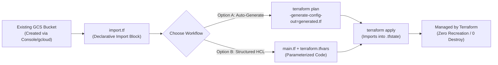

# Reverse Terraform: Google Cloud Storage (GCS) Bucket Import

This directory demonstrates **Reverse Terraform** (also known as *ClickOps-to-IaC* or *Terraform Resource Import*) for an existing Google Cloud Storage bucket. It brings an unmanaged GCS bucket into Terraform state and HCL configuration without downtime or resource recreation.

---

## Target Resource Details

| Attribute | Value |
| :--- | :--- |
| **GCP Project ID** | `yuvaraj-internal-project` |
| **Location / Region** | `asia-south1` (Mumbai) / `ASIA-SOUTH1` |
| **Bucket Name** | `gcp-tfplans-instancetemplate-strorage-bucket` |
| **Cloud Storage URI** | `gs://gcp-tfplans-instancetemplate-strorage-bucket` |
| **Cloud Console URL** | [Open in Google Cloud Console](https://console.cloud.google.com/storage/browser/gcp-tfplans-instancetemplate-strorage-bucket) |
| **Terraform Resource Type** | `google_storage_bucket` |
| **Terraform Resource Address** | `google_storage_bucket.tfplans_bucket` |

---

## How Reverse Terraform Works



---

## Directory Structure

```text
reverse-terraform/
├── .gitignore          # Excludes .terraform/, *.tfstate, and sensitive files
├── providers.tf        # Terraform >= 1.5.0 and hashicorp/google provider setup
├── variables.tf        # Input variable declarations with sensible defaults
├── terraform.tfvars    # Concrete values for yuvaraj-internal-project & bucket
├── import.tf           # Declarative Terraform 1.5+ import block
├── main.tf             # Target google_storage_bucket resource with prevent_destroy
├── outputs.tf          # Useful outputs (GCS URI, self_link, Console URL)
└── README.md           # Complete step-by-step Reverse Terraform documentation
```

---

## Prerequisites

1. **Terraform CLI**: Version **`>= 1.5.0`** (required for config-driven `import {}` blocks and `-generate-config-out`; Terraform `>= 1.8.0` is required if using variable interpolation inside `import.id`, otherwise use literal string `"yuvaraj-internal-project/gcp-tfplans-instancetemplate-strorage-bucket"`).
   ```powershell
   terraform -version
   ```
2. **Google Cloud SDK (`gcloud`)**: Installed and authenticated with Application Default Credentials (ADC).
   ```powershell
   gcloud auth login
   gcloud config set project yuvaraj-internal-project
   gcloud auth application-default login
   ```
3. **IAM Permissions**: Your user or service account needs at least:
   - `roles/storage.admin` (or `storage.buckets.get` + `storage.buckets.getIamPolicy`) on the bucket or project.

---

## Step-by-Step Workflows

You can perform Reverse Terraform using **four methods**. **Method 1** and **Method 2** are the modern HashiCorp-recommended approaches.

---

### Method 1: Config-Driven Import with Pre-Structured HCL (Ready to Run)

This repository already includes a clean, parameterized [`main.tf`](./main.tf) and [`import.tf`](./import.tf).

#### Step 1: Initialize Terraform
```powershell
cd d:\GCP-DevOps-WorkSpace\gcp-terraform-best-practices\reverse-terraform
terraform init
```

#### Step 2: Inspect the Live Bucket Configuration (Optional Pre-Check)
Check the exact live properties of the bucket in GCP so you know if custom labels, versioning, or retention policies are currently set:
```powershell
gcloud storage buckets describe gs://gcp-tfplans-instancetemplate-strorage-bucket --project=yuvaraj-internal-project --format=json
```

#### Step 3: Run `terraform plan`
```powershell
terraform plan
```
**What to look for in the plan output:**
- Terraform will read the live bucket from `yuvaraj-internal-project` and display:
  `Plan: 1 to import, 0 to add, 0 to change, 0 to destroy.`
- If the output shows `1 to import, 0 to add, 1 to change, 0 to destroy`, inspect the `~` (in-place update) attributes in the diff and adjust [`terraform.tfvars`](./terraform.tfvars) (for example, `labels`, `versioning_enabled`, or `soft_delete_retention_duration_seconds`) until `0 to change` is achieved.
- **Safety guarantee**: `lifecycle { prevent_destroy = true }` in [`main.tf`](./main.tf) ensures Terraform will error out rather than ever destroying your bucket.

#### Step 4: Execute the Import (`terraform apply`)
```powershell
terraform apply
```
Type `yes` when prompted. Output will confirm:
```text
Apply complete! Resources: 1 imported, 0 added, 0 changed, 0 destroyed.
```

#### Step 5: Clean Up `import.tf` (Post-Import)
Once the bucket is recorded in `terraform.tfstate`, you can either keep [`import.tf`](./import.tf) as historical documentation or remove/comment it out. Verify state synchronization:
```powershell
terraform state list
terraform state show google_storage_bucket.tfplans_bucket
terraform plan
```

---

### Method 2: Auto-Generate HCL from Live GCP State (`-generate-config-out`)

If you do **not** want to write `main.tf` manually and want Terraform to inspect the bucket in GCP and write the exact HCL code for you:

#### Step 1: Temporarily Disable `main.tf` and `outputs.tf`
Rename `main.tf` and `outputs.tf` so Terraform sees only the `import` block in [`import.tf`](./import.tf):
```powershell
Rename-Item .\main.tf .\main.tf.bak
Rename-Item .\outputs.tf .\outputs.tf.bak
```

#### Step 2: Generate the Configuration File
Run `terraform plan` with the `-generate-config-out` flag:
```powershell
terraform plan -generate-config-out=generated_bucket.tf
```
Terraform queries the Google Cloud API for `gcp-tfplans-instancetemplate-strorage-bucket` and creates `generated_bucket.tf` containing the exact live attributes of the bucket.

#### Step 3: Review and Apply
1. Open `generated_bucket.tf` and review the generated `resource "google_storage_bucket" "tfplans_bucket"` block.
2. Run `terraform apply` to import the resource into state:
   ```powershell
   terraform apply
   ```
3. Refactor the hardcoded values in `generated_bucket.tf` into variables (or restore `main.tf.bak` / `outputs.tf.bak` once aligned).

---

### Method 3: Classic Imperative CLI (`terraform import`)

If you prefer the traditional CLI command without using [`import.tf`](./import.tf):

1. Comment out or delete [`import.tf`](./import.tf).
2. Run the imperative import command:
   ```powershell
   terraform import google_storage_bucket.tfplans_bucket yuvaraj-internal-project/gcp-tfplans-instancetemplate-strorage-bucket
   ```
3. Run `terraform plan` to verify there is no configuration drift between [`main.tf`](./main.tf) and the imported state.

---

### Method 4: GCP Native Export (`gcloud beta resource-config bulk-export`)

Google Cloud also provides a native Config Connector / Terraform exporter via `gcloud`:

```powershell
# Prerequisite: Install config-connector component
gcloud components install config-connector

# Export the bucket directly to Terraform HCL format
gcloud beta resource-config bulk-export `
  --project=yuvaraj-internal-project `
  --resource-types=StorageBucket `
  --resource-format=terraform
```

---

## Troubleshooting Common Issues

| Issue / Error | Cause | Resolution |
| :--- | :--- | :--- |
| `Error: Variables may not be used here` in `import.tf` | Using Terraform `< 1.8.0` (variables in `import.id` require Terraform `>= 1.8.0`). | Upgrade Terraform to `>= 1.8.0`, or replace `id = "${var.project_id}/${var.bucket_name}"` in [`import.tf`](./import.tf) with the literal string `id = "yuvaraj-internal-project/gcp-tfplans-instancetemplate-strorage-bucket"`. |
| `Error 403: Caller does not have storage.buckets.get access` | Missing GCP IAM permissions or wrong active ADC account. | Run `gcloud auth application-default login` with an account that has `Storage Admin` or `Storage Viewer` in `yuvaraj-internal-project`. |
| Plan shows `~ soft_delete_policy` or `~ uniform_bucket_level_access` change | Default variable values in `terraform.tfvars` differ from the live bucket's current settings. | Check the live values shown on the left side of `->` in `terraform plan` output and update [`terraform.tfvars`](./terraform.tfvars) to match. |
| `Instance cannot be destroyed` error | A change to an immutable attribute (`name`, `location`, or `project`) is forcing replacement (`-/+`). | Ensure `location = "ASIA-SOUTH1"` (uppercase) and `bucket_name = "gcp-tfplans-instancetemplate-strorage-bucket"` match the live bucket exactly. |

